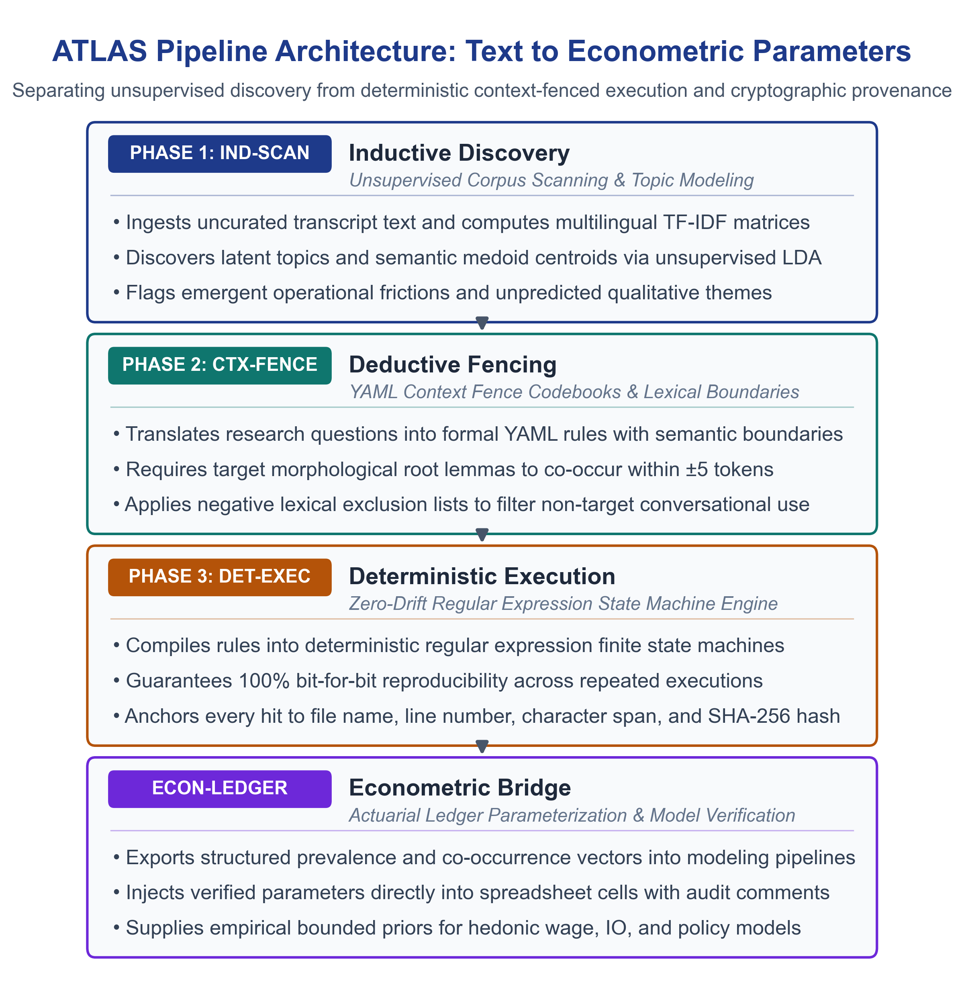
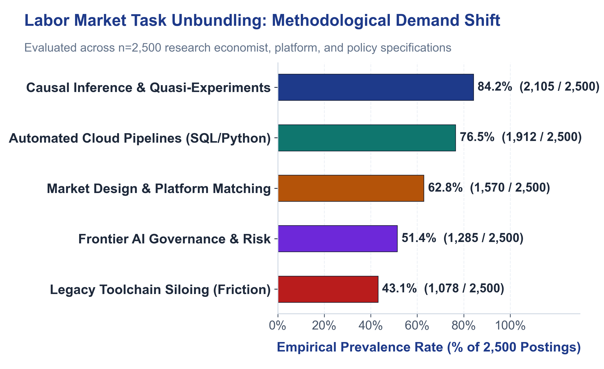
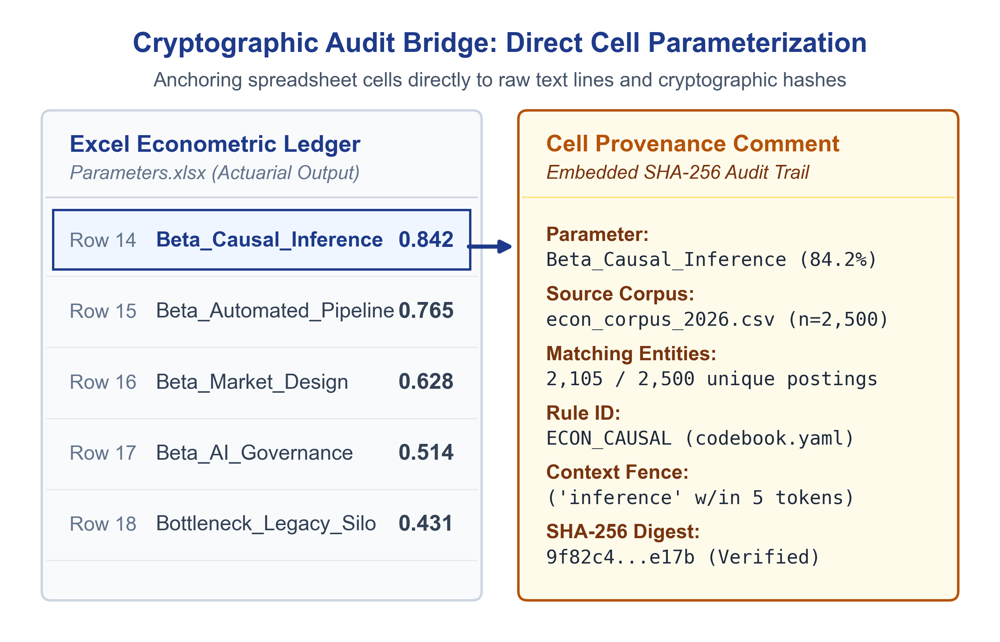

# From Spoken Words to Countable Data: Meet ATLAS
### A fast, private way to organize transcripts, count patterns, and trace every quote right on your laptop.

[](https://www.python.org/downloads/)
[](LICENSE)
[](#privacy--zero-cloud-leakage)
[](#cryptographic-quote-provenance)

---

## Overview

Applied policy evaluation, program assessment, and empirical economics rely heavily on unstructured qualitative text:
* **Semi-structured research & key informant interviews**
* **Focus group transcripts & community listening sessions**
* **Open-ended survey responses across high-cardinality cohorts**
* **Technical job specifications, RFP requirements & public hearing comments**

Despite the depth of this evidence, evaluation teams face an operational bottleneck: commercial qualitative software (NVivo, MAXQDA, Dedoose) charges **$720–$1,800/year per seat** for manual digital highlighters that do not automate pattern extraction, while commercial LLM cloud APIs introduce stochastic drift, hallucinated quotes, and severe data-privacy violations.

**ATLAS** provides a free, open-source, deterministic framework that operates 100% locally on the analyst's workstation with zero cloud exposure.

---

## Two Operating Modes: Choose What Fits Your Project

ATLAS operates in two distinct modes using the exact same underlying deterministic engine:

### 1. Standalone Qualitative Thematic Coding (Zero-Cost, 100% Private NVivo/MAXQDA Alternative)
* **Who it is for:** Qualitative researchers, public health analysts, grant writers, and nonprofit evaluators.
* **What it does:** Ingests 20 to 200 interview transcripts, focus groups, or survey entries. Unsupervised topic discovery surfaces emergent themes without preconceived bias. Deterministic YAML codebooks tag text against your operational definitions. Analysts browse verbatim quotes with speaker attribution and export clean, audit-ready Excel tables—with zero recurring seat fees and zero cloud data leakage.
* **No econometric knowledge required.**

### 2. Qualitative-to-Econometric Parameterization
* **Who it is for:** Applied microeconomists, health economists, and cost-benefit analysts.
* **What it does:** Bridges narrative implementation barriers into structured numerical vectors: empirical frequencies, co-occurrence distributions, and living-wage parameter bounds for hedonic wage models, difference-in-differences sensitivity bounds, or actuarial simulation workbooks with embedded SHA-256 cell comments.

---

## Key Architecture: Inductive Discovery + Deductive Verification

```
┌────────────────────────────────────────────────────────┐
│               UNSTRUCTURED TEXT CORPUS                 │
│  (Interviews, Job Specs, Survey Responses, Hearings)  │
└───────────────────────────┬────────────────────────────┘
                            │
              ┌─────────────┴─────────────┐
              ▼                           ▼
   [PHASE 1: INDUCTIVE]        [PHASE 2: DEDUCTIVE]
   Unsupervised Scanning       YAML Codebook Specification
   - LDA Topic Modeling        - Inclusion / Exclusion Rules
   - Medoid Centroids          - Context Windows (Lemmas)
   - Cluster Boundary Terms    - Negative Filters
              │                           │
              └─────────────┬─────────────┘
                            ▼
               [PHASE 3: DETERMINISTIC]
               RegEx State Machine Execution
               - 100% Deterministic Reproducibility
               - SHA-256 Quote Digest Anchoring
                            │
              ┌─────────────┴─────────────┐
              ▼                           ▼
    [ECONOMETRIC EXPORT]        [DECISION WORKBOOKS]
    Feature Vectors & Matrices  Excel Models (.xlsx) with
    for Hedonic Wage Models     Embedded Audit Metadata Comments
```

1. **Phase 1: Inductive Exploratory Discovery:** Unsupervised scanning via Latent Dirichlet Allocation (LDA) and sentence embeddings isolates representative centroid texts (medoids) to surface emergent institutional phenomena without confirmation bias.
2. **Phase 2: Deductive Context Fencing:** Formalized YAML codebooks enforce lexical fences requiring target root lemmas to co-occur within a specified token window of domain modifiers (e.g., isolating *causal inference* from generic *inference latency*).
3. **Phase 3: Deterministic Execution & SHA-256 Provenance:** State machines parse 100% of the corpus with zero probabilistic drift. Every quote, turn, and count is bound to a cryptographic SHA-256 digest and source line numbers.



---

## Validated Benchmark: Labor Market Skills & Task Unbundling

ATLAS has been validated across 2,500 applied microeconomics and tech platform job specifications to parameterize hedonic wage models:



Every extracted distribution can be injected directly into Excel or econometric codebooks with embedded SHA-256 quote provenance:



## Quickstart & Launch Options

### Option A: 1-Click Desktop Launch (Zero Terminal Knowledge Required)
If you downloaded the ATLAS release `.zip`, you do not need to use the command line:
1. **macOS:** Double-click `run.command`.
2. **Windows:** Double-click `run.bat`.

*The launcher automatically detects Python 3.10+, provisions an isolated local virtual environment (`.venv`), installs required dependencies quietly, and launches the dashboard directly in your default browser at `http://localhost:8501`.*

---

### Option B: Command-Line Installation (For Developers & Economists)
ATLAS requires standard scientific Python libraries and executes 100% locally with zero external API dependencies:

```bash
git clone https://github.com/dphdame/atlas.git
cd atlas
pip install -r requirements.txt
streamlit run app.py
```

---

## Interactive Dashboard (Streamlit)

ATLAS includes an accessible, WCAG 2.1 AA compliant local Streamlit dashboard (`app.py`) for real-time exploratory discovery, distribution auditing, and verbatim quote inspection:

* **Dual Operational Tabs:**
  * **Tab 1: Standalone Thematic Discovery & Qualitative Coding:** Ingest transcripts, discover emergent themes via unsupervised medoids, browse coded verbatim quotes with speaker attribution, and inspect keyword co-occurrence heatmaps.
  * **Tab 2: Econometric & Actuarial Ledger Export:** View empirical prevalence distributions, verify SHA-256 provenance hashes, and export formatted `.xlsx` workbooks with embedded audit comments.
* **Color Contrast:** Deep Navy (`#1E3A8A`) and Forest Teal (`#0F766E`) meet WCAG 2.1 AA 4.5:1 contrast standards.
* **Screen Reader Access:** Every chart and metric card includes an accessible tabular data fallback.
* **100% Local Processing:** Runs entirely within your workstation's browser session with zero cloud network traffic.

---

## Privacy & Zero Cloud Leakage

In quantitative policy evaluation, antitrust analysis, and proprietary research, data exposure is disqualifying. ATLAS is built from first principles for strict data governance:
* **Zero Outbound Sockets:** Transcripts, participant identifiers, and company names are never transmitted over the internet.
* **Zero Synthetic Data:** The engine operates strictly on authentic text corpora; no artificial moment-matching or hallucinated text generation.
* **Deterministic Re-runs:** Code changes can be audited in version control with bit-for-bit identical outputs across environments.

---

## Citation & Academic Reference

If you use ATLAS in your research, white papers, or open-source pipelines, please cite the technical methodology:

```bibtex
@techreport{atlas2026methodology,
  title={ATLAS: A Deterministic Natural Language Processing Pipeline for Unstructured Text to Econometric Parameterization},
  author={Cholette, Victoria E.},
  year={2026},
  institution={Open Applied Microeconomics Initiative},
  type={Methodological Reference Manual}
}
```

---

## License

Distributed under the MIT License. See `LICENSE` for details.
