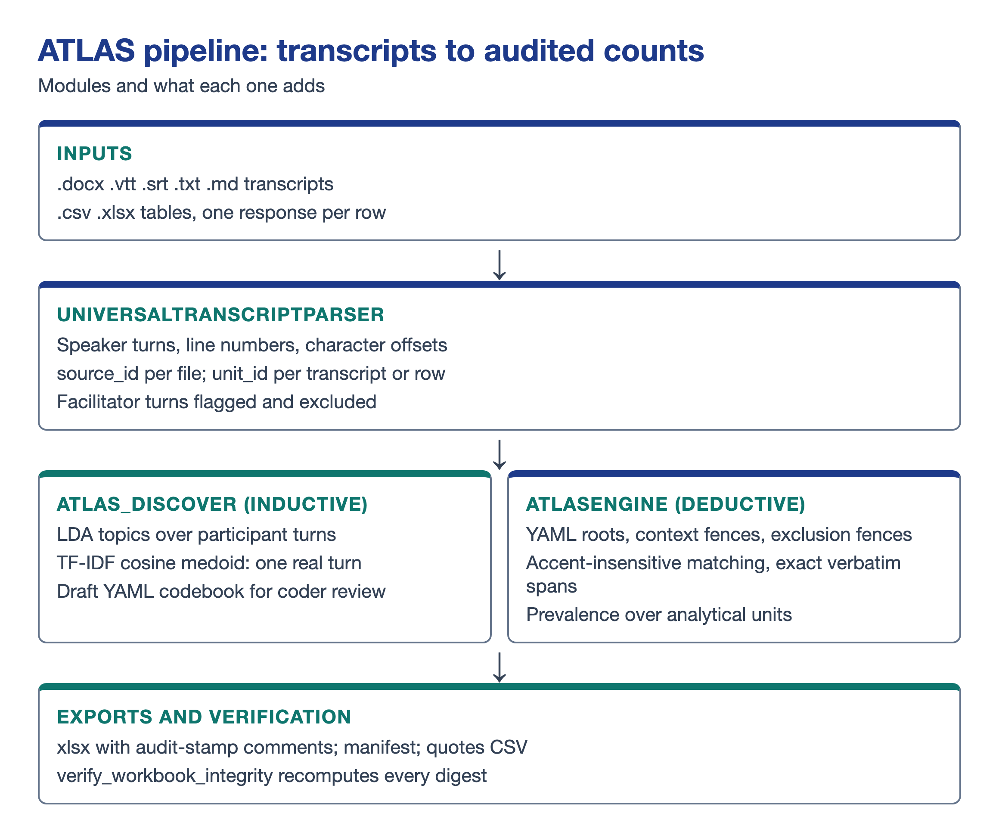
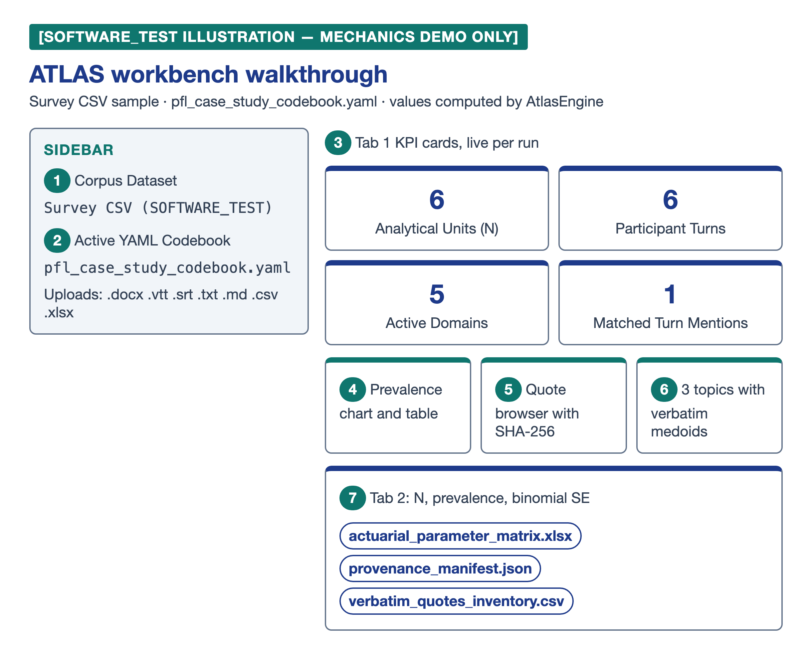
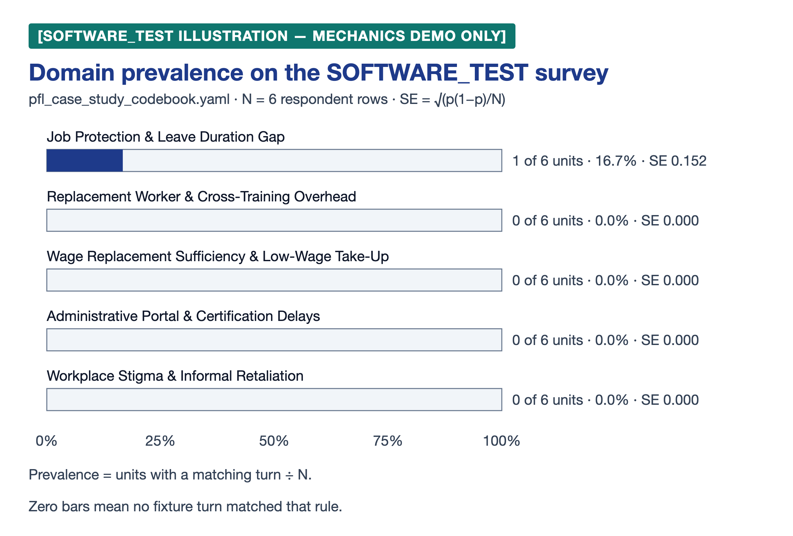
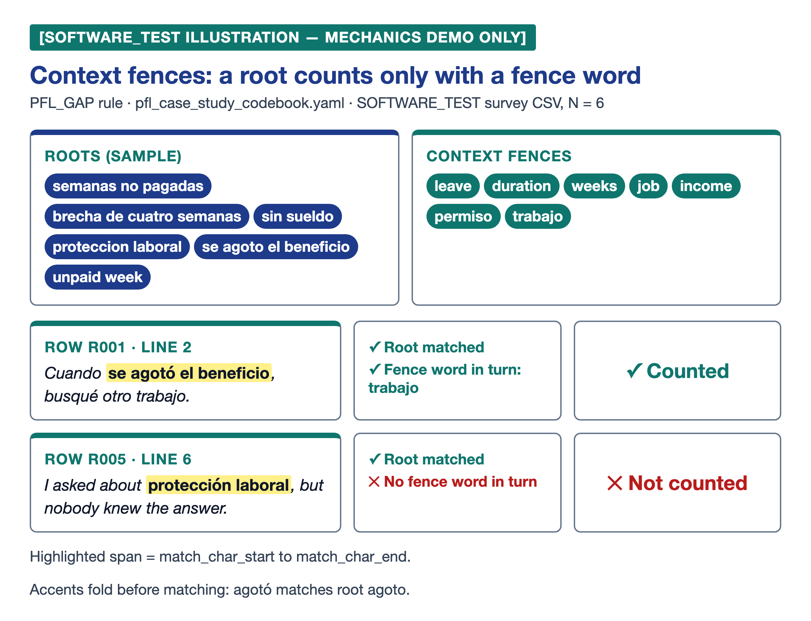
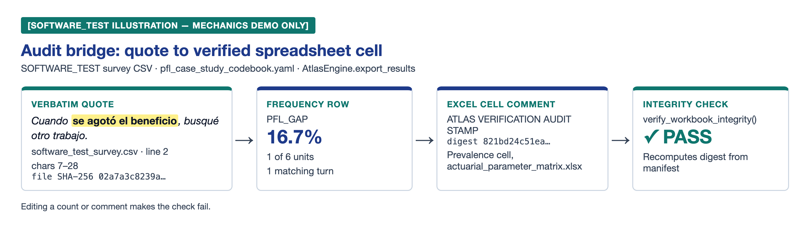

# ATLAS
### Automated Text-to-Ledger Actuarial Synthesis — local qualitative coding, topic discovery, and auditable frequency exports for transcripts and survey tables.

**Python 3.10+ · MIT License · local processing · SHA-256 source provenance**

---

## Overview

ATLAS (Automated Text-to-Ledger Actuarial Synthesis) turns interview transcripts, focus-group
recordings exported as text, and open-ended survey tables into counts that can be checked line by line:

* **Parse** `.docx` (including 3-column focus-group notes tables), `.vtt`, `.srt`, `.txt`, `.md`
  transcripts and `.csv` / `.xlsx` response tables into speaker-attributed turns (`universal_transcript_parser.py`).
* **Discover** emergent topics with TF-IDF + NMF (default) or LDA and show each topic's TF-IDF medoid, a real
  participant turn or coded notes entry (`atlas_discover.py`).
* **Code** every participant turn against a YAML codebook with root terms (prefix or exact-word `match_mode`),
  context fences and exclusion fences, and report prevalence over individual units or focus groups (`atlas_engine.py`).
* **Export** an `.xlsx` parameter matrix whose prevalence cells carry an `ATLAS VERIFICATION AUDIT STAMP`
  comment, a `provenance_manifest.json`, and a verbatim quote inventory, then re-verify the workbook
  against the manifest (`AtlasEngine.verify_workbook_integrity`).

Parsing, coding, discovery and export all run on the local machine, and ATLAS code makes no network
requests; see [Privacy and network use](#privacy-and-network-use) for what that does and does not cover.

> **About the numbers in this repository.** Every count, quote and figure in this README and in `docs/`
> comes from the built-in `SOFTWARE_TEST` fixtures in `data/samples/`. They demonstrate software
> mechanics only and are not empirical research findings.



---

## Quickstart

### Option A: desktop launcher
1. **macOS / Linux:** double-click `run.command` (or run `./run.command`).
2. **Windows:** double-click `run.bat`.

The launcher finds Python 3.10+, creates `.venv`, installs `requirements.txt` when the environment is
missing or the requirements changed (tracked by `.venv/.atlas_deps.sha256`), checks the core imports and
opens the workbench at `http://localhost:8501`.

`./run.command --check-only` (or `run.bat --check-only`, or `ATLAS_NO_LAUNCH=1`) provisions and verifies
the environment, then exits 0 without launching the app.

### Option B: command line
```bash
git clone https://github.com/dphdame/atlas.git
cd atlas
python -m venv .venv && .venv/bin/pip install -r requirements.txt
.venv/bin/streamlit run app.py --server.address=localhost --browser.gatherUsageStats=false
```

Installing dependencies needs a network connection; analysis does not.

---

## The workbench (`app.py`)



**Sidebar**
* **Corpus Dataset:** three built-in `SOFTWARE_TEST` samples (bilingual interview `.txt` + Zoom `.vtt`;
  community survey `.csv`; Teams `.docx`) or **Upload Custom Files**. For uploaded `.csv` / `.xlsx`
  tables the free-text column is detected automatically (columns named `id` or ending in `_id` are never
  chosen) and can be changed; optional respondent-id and speaker columns, facilitator names and
  interviewer prompt patterns are also available.
* **Active YAML Codebook:** every `.yaml` file in `config/`, an uploaded codebook, or a codebook applied
  from topic discovery during the session.
* A `SOFTWARE_TEST FIXTURE ACTIVE` notice is shown whenever a built-in sample is loaded.

**Tab 1: Standalone Thematic Discovery & Qualitative Coding**
* KPI cards: **Analytical Units (N)**, **Participant Turns**, **Active Domains**, **Matched Turn Mentions**.
* Prevalence chart and accessible table; a quote browser (search, domain and speaker filters) showing
  each verbatim turn with its matched span, `source_id`, `unit_id`, line, `match_char_start`–`match_char_end`
  and `source_sha256`; topic discovery with a topic-count slider, representative medoids (verbatim turns
  for transcripts, or coded notes entries for structured focus-group notes), a
  **Download Discovered Codebook (.yaml)** button and an **Apply Discovered Codebook to Engine** button.

**Tab 2: Econometric & Actuarial Ledger Export**
* Parameter matrix with N (analytical units), units reporting, prevalence, `p`, binomial
  SE = √(p(1 − p)/N) and a normal-approximation 95% interval.
* Downloads produced by `AtlasEngine.export_results`: `actuarial_parameter_matrix.xlsx`,
  `provenance_manifest.json`, `verbatim_quotes_inventory.csv`, plus the workbook integrity result.

### SOFTWARE_TEST walkthrough: survey sample × `pfl_case_study_codebook.yaml`

Output of `AtlasEngine` on `data/samples/software_test_survey.csv` (`text_col="response"`,
`id_col="respondent_id"`, `speaker_col="role"`). The file has 7 data rows; the blank R004 response is
skipped, so N = 6 analytical units and 6 participant turns.

| Domain ID | Domain | Units reporting | N | Prevalence (%) | Binomial SE | Matching turns |
| :--- | :--- | ---: | ---: | ---: | ---: | ---: |
| `PFL_GAP` | Job Protection & Leave Duration Gap | 1 | 6 | 16.7 | 0.152 | 1 |
| `PFL_REPLACE` | Replacement Worker & Cross-Training Overhead | 0 | 6 | 0.0 | 0.000 | 0 |
| `PFL_WAGE` | Wage Replacement Sufficiency & Low-Wage Take-Up | 0 | 6 | 0.0 | 0.000 | 0 |
| `PFL_PORTAL` | Administrative Portal & Certification Delays | 0 | 6 | 0.0 | 0.000 | 0 |
| `PFL_STIGMA` | Workplace Stigma & Informal Retaliation | 0 | 6 | 0.0 | 0.000 | 0 |



---

## How coding works

* **Roots.** Each domain lists root terms (`roots_en`, `roots_es`, or `keywords`). A root matches
  case-insensitively at the start of a word, so `childcare` also matches `childcares`.
* **Accent-insensitive matching with exact spans.** Text and terms are folded by removing Unicode
  combining marks after per-character NFD decomposition, so NFC `é` and NFD `e` + U+0301 both match `e`.
  Characters without a canonical decomposition (`fi`, `ß`) are kept as they are. Each match is mapped back
  to `match_char_start` / `match_char_end` in the original, unmodified turn text.
* **Context fences.** With `context_fences` set, a root counts only if a fence term occurs in the same
  turn; with `context_window: N` as well, the fence must be within N tokens of the root. A
  `context_window` without fences has no effect.
* **Exclusion fences.** With `exclude_fences` and no `exclude_window`, any exclusion term in a turn
  vetoes the domain for that turn; with `exclude_window: N`, only roots within N tokens of an exclusion
  term are vetoed.
* **Facilitators.** Facilitator turns are excluded from coding. They are named speakers given in
  `facilitator_names`, or, when none are given, a named speaker who asked more than half of at least
  three questions in a transcript. Speakerless lines matching an `interviewer_prompt_patterns` regex are
  also excluded.



### `source_id` and `unit_id`
* `source_id` identifies a file: its POSIX path relative to `root_dir` (for example
  `data/samples/software_test_survey.csv`), or its absolute path when no root is given.
* `unit_id` identifies an analytical unit: the `source_id` for a transcript, and
  `<source_id>::<id>` for a table row with an id column (`<source_id>#row_<line>` when that id cell is
  blank, `<source_id>::row_<line>` when no id column is set).
* Prevalence = distinct `unit_id`s with at least one matching participant turn ÷ all analytical units.

### Provenance and verification
Each quote row carries `source_id`, `unit_id`, `line_number`, `speaker`, `timestamp`, the verbatim
`text`, `match_char_start`, `match_char_end`, `match_text` and the source file's `source_sha256`. Each
prevalence cell in the exported workbook carries an audit-stamp comment with a digest computed from the
domain's counts and every source file's SHA-256. `verify_workbook_integrity` recomputes prevalence,
digests and statements from the manifest and checks every cell of the frequency sheet against them, so
an edited count, comment or statement is reported. It does not re-verify the quote sheet or re-hash the
source files; compare `source_sha256` with the files on disk for that.



---

## Privacy and network use

* **What ATLAS controls.** `app.py`, `atlas_engine.py`, `atlas_discover.py` and
  `universal_transcript_parser.py` import none of `subprocess`, `urllib`, `requests`, `httpx` or
  `aiohttp` (enforced by `scripts/anti_shortcut_gate.py`). The app reads only the selected or uploaded
  files plus `config/`, `data/samples/` and `docs/` inside the ATLAS folder, and renders no remote images,
  fonts or scripts. `scripts/smoke_test.py` runs the unit tests, pipeline and app checks under an offline
  guard that blocks and logs any socket use; a logged call fails the run.
* **What Streamlit does.** The workbench is a local Streamlit web server. The desktop launchers start it
  with `--browser.gatherUsageStats=false` so Streamlit's usage statistics are off. They do not set
  `--server.address`, so Streamlit also listens on the computer's network interfaces and other machines
  on the same network could open the page; add `--server.address=localhost` (as in Option B) on shared
  networks. The offline guard is a test harness and is not active during a normal launch.
* **What ATLAS cannot control.** Operating-system services, backup or sync software, and the browser
  itself are outside ATLAS; keep sensitive transcripts in folders that are not synced to cloud storage.

---

## Python API

```python
from atlas_engine import AtlasEngine
from atlas_discover import discover_topics

engine = AtlasEngine("config/pfl_case_study_codebook.yaml")
results = engine.process_corpus(
    ["data/samples/software_test_survey.csv"],
    root_dir=".",
    tabular_options={"text_col": "response", "id_col": "respondent_id", "speaker_col": "role"},
)
results["frequencies_df"]          # one row per domain
results["quotes_df"]               # one row per matched participant turn and domain
topics = discover_topics(results["tagged_turns_df"].to_dict("records"), n_topics=3)["topics"]
engine.export_results(results, "outputs/")   # CSV, Parquet, .xlsx and provenance_manifest.json
ok, problems = AtlasEngine.verify_workbook_integrity(
    "outputs/actuarial_parameter_matrix.xlsx", "outputs/provenance_manifest.json")
```

---

## Documentation

* [GBI Analyst Quick-Start Guide](docs/ATLAS_GBI_Analyst_Quick_Start.md): 1-page offline workflow
  for coding multi-group focus-group `.docx` notes in Group Mode.
* [User Guide](docs/ATLAS_User_Guide.md): installing, loading data, reading every screen, exports.
* [Methodology & Reference Manual](docs/ATLAS_Methodology_and_Reference_Manual.md): matching rules,
  units, discovery, provenance and a full `SOFTWARE_TEST` walkthrough.
* [Practitioner Field Guide](docs/ATLAS_Practitioner_Field_Guide_Program_Evaluation.md): writing
  evaluation findings and building codebooks.

Figures in `docs/figures/` are regenerated from live engine output with
`.venv/bin/python scripts/generate_docs_figures.py`; `--tables` prints the walkthrough tables used in
these documents.

---

## Testing

```bash
.venv/bin/python -m unittest discover -s tests -v
.venv/bin/python scripts/anti_shortcut_gate.py --repo . --slice 4
.venv/bin/python scripts/smoke_test.py --max-stage 5
```

The smoke test copies the repository to a temporary folder and runs each stage there with the offline
guard (`scripts/offline_guard/sitecustomize.py`, `ATLAS_OFFLINE_GUARD=1`), which blocks and logs any
network call; a logged call fails the run.

---

## Citation

```bibtex
@software{cholette2026atlas,
  title  = {ATLAS: Automated Text-to-Ledger Actuarial Synthesis},
  author = {Cholette, Victoria E.},
  year   = {2026},
  url    = {https://github.com/dphdame/atlas}
}
```

## License

Distributed under the MIT License. See [LICENSE](LICENSE).
