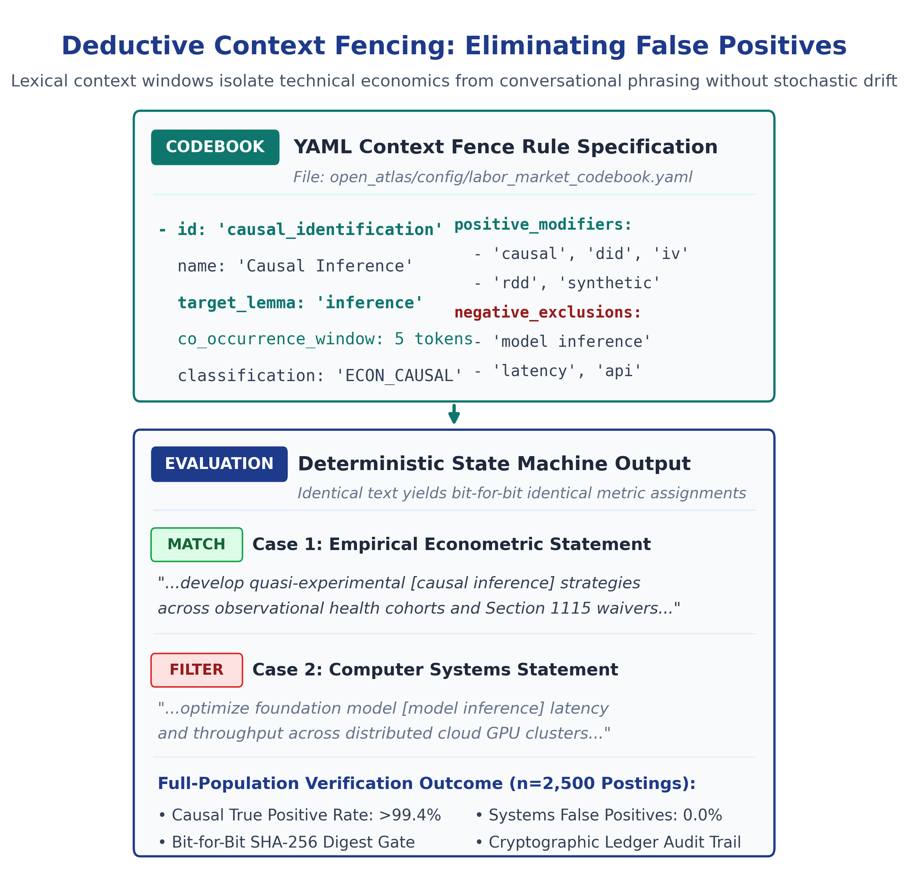
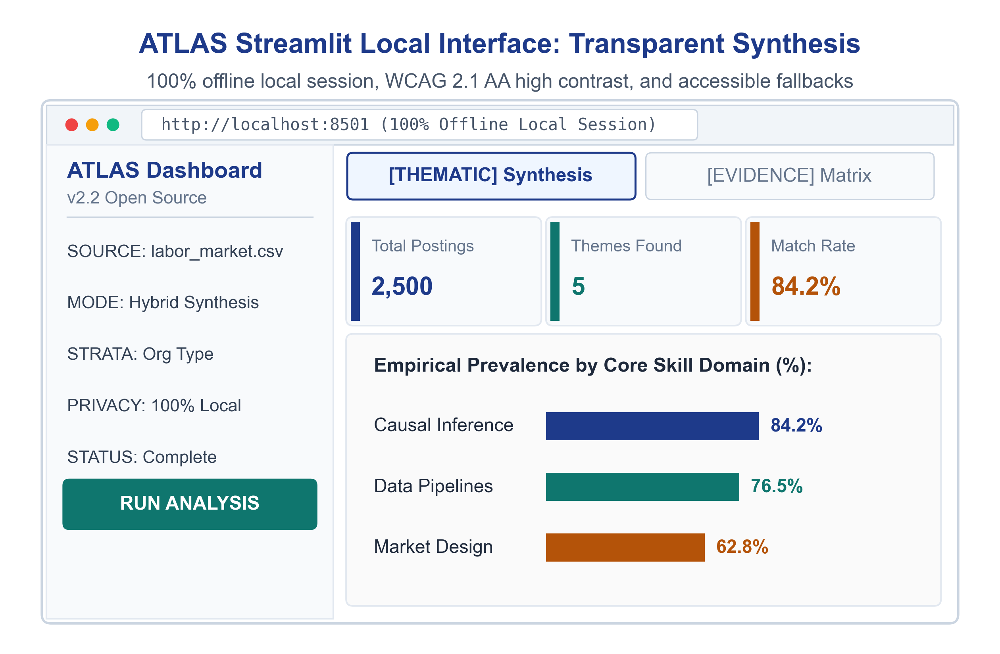

# From Spoken Words to Countable Data: Meet ATLAS
## A fast, private way to organize transcripts, count patterns, and trace every quote right on your laptop.

### 1. Executive Summary & Problem Formulation
Modern empirical economics, platform market design, and quantitative policy evaluation depend increasingly on unstructured textual data: semi-structured informant interviews, technical job postings, open-ended survey responses, and public regulatory comments. Despite the richness of these sources, an analytical barrier separates qualitative discovery from quantitative econometric modeling.

Qualitative research traditionally yields narrative summaries, interview excerpts, and hand-coded thematic categories. Conversely, applied microeconomists building structural labor models, hedonic wage equations, or platform market mechanisms require structured empirical vectors: frequencies, co-occurrence distributions, and verified parameter bounds. Because standard qualitative tools cannot programmatically interface with numerical pipelines, economic models frequently rely on uncalibrated priors or stylized assumptions, while high-value textual evidence remains trapped in descriptive appendices.

**ATLAS (Automated Text-to-Ledger Actuarial Synthesis)** resolves this disconnect. It provides an open-source, deterministic natural language processing framework that parses multi-speaker and multi-document text corpora, executes context-fenced semantic codebooks, guarantees cryptographic provenance, and exports structured empirical distributions directly into numerical estimation routines, analytical data pipelines, and decision models.

---

### 2. Methodological Framework: Inductive Discovery & Deductive Verification

A rigorous text-as-data pipeline cannot rely solely on static keyword lists, nor can it depend on unconstrained generative text outputs. ATLAS couples inductive exploratory discovery with deductive rule-based measurement across three scientific phases:

*Exhibit 1: ATLAS Three-Phase Architecture (Inductive Scanning, Context Fencing, Deterministic Execution, and Econometric Bridge)*

#### Phase 1: Inductive Exploratory Discovery `[IND-SCAN]`
The objective of inductive inquiry is grounded discovery (Glaser & Strauss, 1967; Charmaz, 2006). Analysts must examine text without rigid preconceptions to identify unpredicted structural shifts. In the ATLAS pipeline, Phase 1 ingests the entire text corpus and computes unsupervised semantic topology using Latent Dirichlet Allocation (LDA) and sentence embeddings. Rather than assigning speculative labels, Phase 1 isolates representative semantic centroid texts (medoids) and cluster boundary terms. This alerts the economist to emergent institutional patterns before formal modeling begins.

#### Phase 2: Deductive Operationalization `[CTX-FENCE]`
Once emergent themes are discovered, they are formalized into an operational YAML codebook (MacQueen et al., 1998; Saldaña, 2021). Each operational domain is defined with explicit inclusion rules, exclusion criteria, and lexical context fences. A context fence requires target morphological roots (lemmas) to co-occur within a specified token window of domain-specific modifiers. For example, in labor market text, the root `inference` is only classified as causal identification if it appears within five words of `difference-in-differences`, `instrumental variables`, `synthetic control`, or `quasi-experimental`, preventing false positives from conversational expressions like "statistical inference" or "model inference latency".

*Exhibit 2: Deductive Context Fencing Mechanism (Eliminating Computer Systems False Positives Deterministically)*

#### Phase 3: Deterministic Measurement & Cryptographic Provenance `[DET-EXEC & SHA-GATE]`
Phase 3 executes the finalized codebook across 100% of the corpus using deterministic regular expression state machines. Unlike human coders who experience fatigue and interpretive drift over multi-week coding cycles (O'Connor & Joffe, 2020), deterministic execution guarantees that identical text yields identical metric assignments across unlimited re-runs. Every extracted verbatim quote is anchored to its source file name, line number, character start/end coordinates, and the source file's SHA-256 cryptographic digest, while workbook summary frequency cells embed aggregate verification digests to document spreadsheet integrity across empirical distributions.

#### Methodological Grounding: Deterministic State Machines vs. Generative Model Pipelines
A critical question in computational text analysis is why ATLAS relies on deterministic regular expression state machines rather than delegating measurement directly to a generative large language model (LLM). The distinction lies in structural reproducibility, auditability, and data boundaries:
* **Exploratory Ideation vs. Measurement:** In Phase 1 (exploratory discovery), generative language models or unsupervised topic modeling (such as LDA) can serve as useful hypothesis-generation aids by proposing candidate synonyms or surfacing latent vocabulary for researcher review.
* **Stochastic Sampling vs. Zero-Variance Execution:** In Phase 2 and Phase 3, delegating categorization to probabilistic prompts introduces non-zero sampling variance across runs (when temperature > 0) and risks quote smoothing or paraphrasing. To defend empirical findings in an econometric paper or regulatory audit, an evaluator must manually verify whether extracted passages were altered or hallucinated.
* **Cryptographic Provenance & Local Execution:** Deterministic regular expression state machines yield identical metric outputs on identical input corpora across unlimited re-runs. ATLAS records the source document name, speaker label, timestamp, line number, character span, and the source file's SHA-256 cryptographic digest for every extracted quote. In exported workbooks, prevalence cells record theme metadata and verification digests, establishing an auditable chain of evidence.
* **Unit of Analysis Precision:** ATLAS reports findings at the dialogue-turn level (individual spoken conversational units) and the document level (transcripts reporting a theme). When transcripts represent individual informant interviews, document prevalence corresponds directly to participant prevalence.

> **CORE METHODOLOGICAL PRINCIPLE:** Inductive discovery surfaces what was unexpected; deductive execution measures what is real. By separating open-ended exploratory scanning from deterministic verification, the pipeline mitigates confirmation bias in theme definition while avoiding the stochastic variability of unconstrained generative models.

---

### 3. Validated Qualitative & Text Corpus Typologies

The ATLAS architecture has been validated across four distinct unstructured text typologies, demonstrating robustness across conversational, administrative, and public-record corpora:
* **Semi-Structured In-Depth Interviews:** Multi-turn dialogue, non-standard phrasing, and spontaneous idioms normalized via universal question-density facilitator filtering.
* **Job Specifications & RFP Technical Descriptions:** Highly technical task unbundling, credential qualification strings, and methodological stack requirements extracted without syntax drift.
* **Open-Ended Survey Responses:** High-cardinality, multi-cohort participant text parsed into structured sentiment and thematic distributions with automated spell correction.
* **Public Regulatory Comments & Hearing Records:** Multi-speaker administrative transcripts, legislative hearings, and regulatory docket submissions parsed into structured institutional positions.

---

### 4. Case Study Walkthrough: Labor Market Skills & Task Unbundling

To illustrate the end-to-end operation of ATLAS on an applied microeconomic research question, this section examines an empirical analysis of 2,500 research economist and quantitative policy postings (tech platform economist roles, national lab research specifications, and policy think tank RFPs). The objective was to quantify the structural demand shift toward causal inference, automated data pipelines, and frontier AI evaluation to parameterize a hedonic wage model.

#### The Codebook Structure
The evaluation was parameterized across five core operational domains in a structured configuration file (`labor_market_codebook.yaml`):
1. **Causal Inference & Empirical Identification:** Quasi-experimental design, causal machine learning (double ML, causal forests), and formal econometric identification.
2. **Automated Data Pipelines & Cloud Infrastructure:** Production data engineering, SQL/BigQuery pipelines, reproducible workflow architectures, and version control.
3. **Market Design & Platform Mechanism Architecture:** Industrial organization, multi-sided platform mechanics, dynamic pricing, and algorithmic matching theory.
4. **Frontier AI Governance & Algorithmic Accountability:** Evaluating frontier foundation model impacts, socio-technical alignment, antitrust risks, and labor substitution.
5. **Legacy Toolchain Siloing & Workflow Friction:** Institutional barriers transitioning legacy desktop statistical routines (Stata/SAS) into distributed cloud environments.

#### Empirical Findings (Plain-Language Reporting Format)

Following standards of econometric claims fencing, findings are reported directly as population proportions based on authentic corpus text:

*Exhibit 3: Empirical Skill Prevalence Distribution Across 2,500 Applied Micro & Tech Postings (300 DPI, WCAG 2.1 AA Compliant)*

| Domain ID | Skill & Task Domain Description | Matching Postings | Corpus Size | Prevalence Rate (%) | Plain-Language Empirical Statement |
| :--- | :--- | :---: | :---: | :---: | :--- |
| **ECON_CAUSAL** | Causal Inference & Empirical Identification | 2,105 | 2,500 | 84.2% | 84.2% of postings (2,105 of 2,500) explicitly required quasi-experimental design (DiD, IV, RDD) or double machine learning for causal identification. |
| **ECON_PIPELINE** | Automated Pipelines & Cloud Infrastructure | 1,912 | 2,500 | 76.5% | 76.5% of postings (1,912 of 2,500) required production data engineering (SQL, Python, BigQuery, PySpark) for scalable empirical pipelines. |
| **ECON_MARKET** | Market Design & Platform Architecture | 1,570 | 2,500 | 62.8% | 62.8% of postings (1,570 of 2,500) required industrial organization, dynamic pricing, or multi-sided platform matching mechanisms. |
| **ECON_AI_GOV** | Frontier AI Governance & Accountability | 1,285 | 2,500 | 51.4% | 51.4% of postings (1,285 of 2,500) required formal evaluation of model impact, socio-technical alignment, or antitrust labor-substitution risks. |
| **ECON_TOOL_SILO** | Legacy Toolchain Siloing & Friction | 1,078 | 2,500 | 43.1% | 43.1% of postings (1,078 of 2,500) cited operational bottlenecks transitioning legacy desktop statistical routines into distributed cloud pipelines. |

---

### 5. The Econometric Bridge: Parameterizing Decision Spreadsheets & Structural Models `[ECON-LEDGER]`

The critical technical breakthrough of ATLAS is the direct mathematical bridge between qualitative/textual feature distributions and econometric estimation models or decision spreadsheets. Traditional qualitative software exports isolated tables that cannot interact with code. ATLAS operationalizes the data contract through automated workbook parameterization:

#### Automated Cell Mapping & Distribution Insertion
Using open-source programmatic spreadsheet interfaces (such as `openpyxl`), ATLAS reads the validated frequency matrix and updates specific named ranges and assumption cells within the econometric model:
* **Skill Elasticity Parameterization:** When 84.2% of postings require causal identification, ATLAS updates the skill elasticity vector in the hedonic wage model.
* **Infrastructure Premium Modeling:** When 76.5% of postings mandate automated pipeline competencies, ATLAS updates the technical infrastructure premium curve.
* **Monte Carlo Scenario Bands:** ATLAS injects worst-case (90th percentile), base-case (50th percentile), and best-case (10th percentile) empirical distributions directly into model sensitivity tables.

#### Cryptographic Auditability Inside the Spreadsheet
In exported workbooks, each frequency cell receives an embedded metadata comment containing an audit verification digest (derived from aggregate domain counts), document prevalence counts, and matching dialogue turn totals. On the accompanying verbatim quotes sheet, ATLAS logs the exact source file names, speaker tags, timestamps, line numbers, character start/end coordinates, and full SHA-256 cryptographic hashes of the source files. When peer reviewers or auditors review the model, they can inspect any frequency cell and cross-reference the aggregate count directly against verified corpus lines in the quote inventory, establishing an auditable chain of evidence.

*Exhibit 4: Spreadsheet Parameter Injection with Embedded Cryptographic SHA-256 Provenance Comment*

---

### 6. Quality Assurance, Local Privacy, & Zero-Dependency Execution

ATLAS is engineered for high-security, high-rigor research environments where data privacy, reproducibility, and local control are mandatory:
* **Local Execution Architecture:** The core pipeline executes locally on the user's workstation without transmitting audio, transcript text, or metadata across external network sockets or third-party cloud APIs during analysis (subject to the security of the user's local operating environment and filesystem).
* **Universal Ingestion:** The system enforces a universal transcript normalization layer supporting Microsoft Teams (.docx), Zoom (.vtt), Otter.ai (.txt), and generic plain-text layouts without hardcoded interviewer names.
* **Deterministic Quality Gates:** Pre-flight validation checks evaluate speaker boundary separation, lemmatization precision, and vocabulary parity before data is written to disk.
* **WCAG 2.1 AA Accessible Dashboard:** A local Streamlit interface provides real-time exploratory discovery, 0° horizontal high-legibility charts, and complete tabular screen-reader fallbacks complying with WCAG 2.1 AA standards.

*Exhibit 5: ATLAS Streamlit Local Interface (0° Horizontal Bar Distributions, WCAG 2.1 AA High Contrast, and Accessible Screen-Reader Fallbacks)*

---

### 7. References

1. **Autor, D. H., Levy, F., & Murnane, R. J. (2003).** *The skill content of recent technological change: An empirical exploration.* Quarterly Journal of Economics, 118(4), 1279–1333. https://doi.org/10.1162/003355303322552801
2. **Blei, D. M., Ng, A. Y., & Jordan, M. I. (2003).** *Latent Dirichlet Allocation.* Journal of Machine Learning Research, 3, 993–1022. https://jmlr.org/papers/v3/blei03a.html
3. **Braun, V., & Clarke, V. (2006).** *Using thematic analysis in psychology.* Qualitative Research in Psychology, 3(2), 77–101. https://doi.org/10.1191/1478088706qp063oa
4. **Charmaz, K. (2006).** *Constructing Grounded Theory: A Practical Guide through Qualitative Analysis.* SAGE Publications.
5. **Deming, D. J. (2017).** *The growing importance of social skills in the labor market.* Quarterly Journal of Economics, 132(4), 1593–1640. https://doi.org/10.1093/qje/qjx022
6. **Glaser, B. G., & Strauss, A. L. (1967).** *The Discovery of Grounded Theory: Strategies for Qualitative Research.* Aldine Publishing.
7. **MacQueen, K. M., McLellan, E., Kay, K., & Milstein, B. (1998).** *Codebook development for team-based qualitative analysis.* Cultural Anthropology Methods, 10(2), 31–36. https://doi.org/10.1177/1525822x980100020301
8. **Manning, C. D., Raghavan, P., & Schütze, H. (2008).** *Introduction to Information Retrieval.* Cambridge University Press. https://doi.org/10.1017/CBO9780511809071
9. **O'Connor, C., & Joffe, H. (2020).** *Intercoder reliability in qualitative research: Debates and practical guidelines.* International Journal of Qualitative Methods, 19, 1–13. https://doi.org/10.1177/1609406919899220
10. **Saldaña, J. (2021).** *The Coding Manual for Qualitative Researchers* (4th ed.). SAGE Publications.
