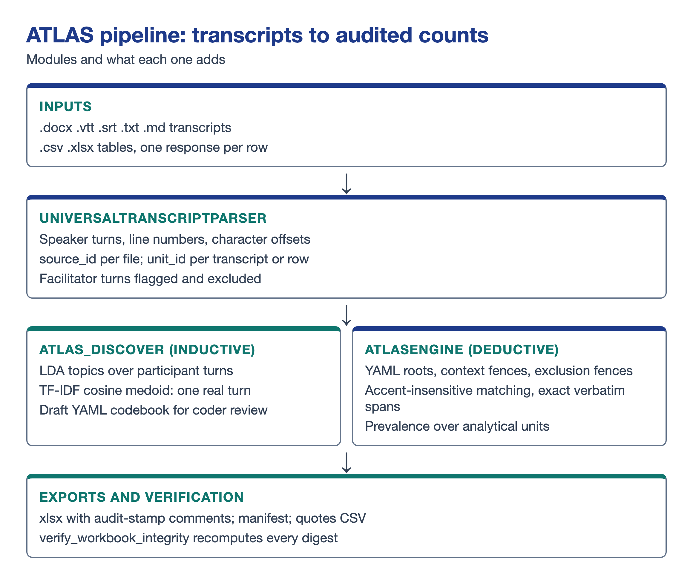
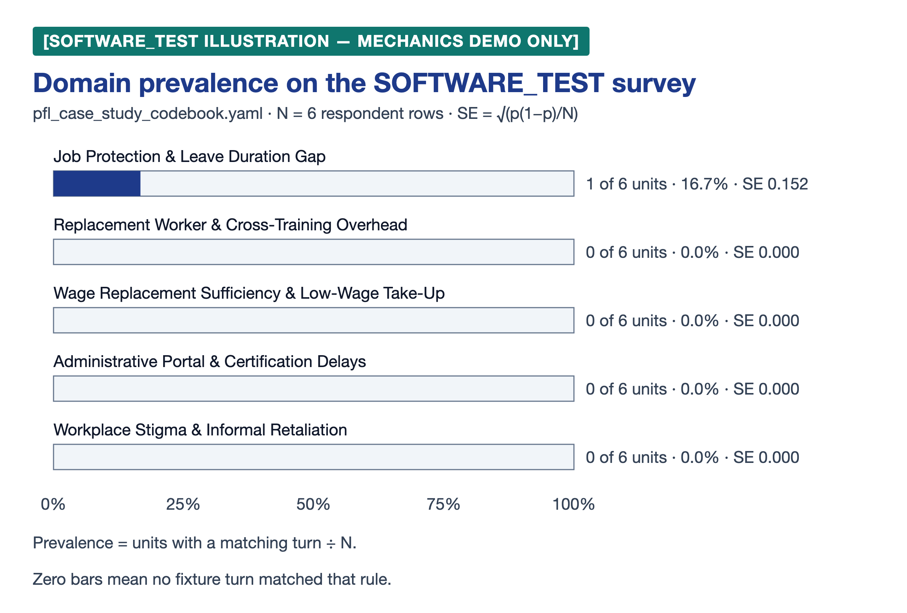
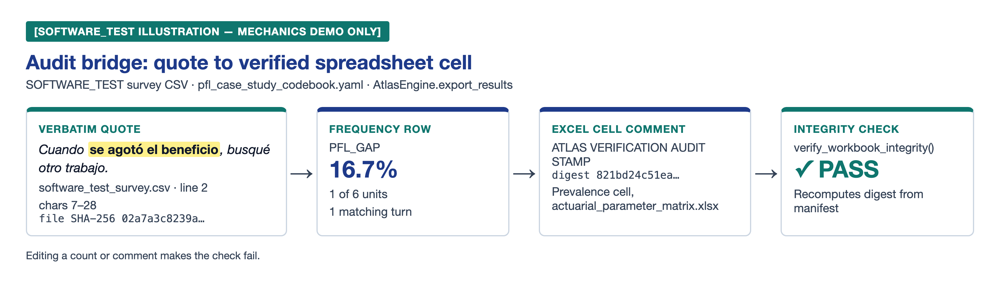
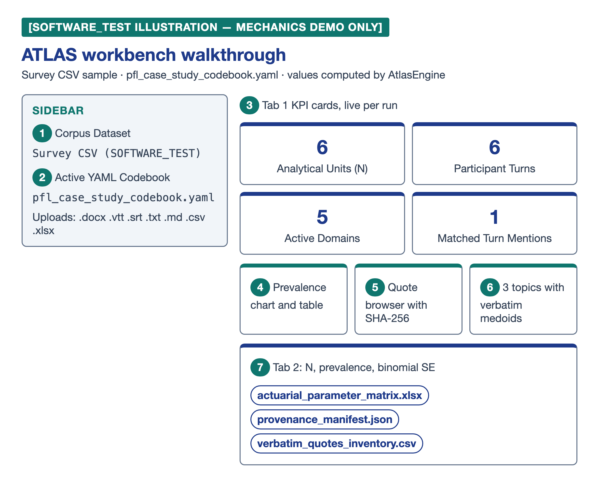

# ATLAS: Methodology & Reference Manual (`v1.2`)

**ATLAS connects qualitative text to auditable quantitative counts by pairing offline inductive topic discovery with deterministic, hash-anchored deductive coding.** This manual defines the exact algorithms, matching semantics, units of analysis, statistical guardrails, and integrity checks implemented in `universal_transcript_parser.py`, `atlas_discover.py`, `atlas_engine.py`, and `app.py`.

> Every count, quote, digest and figure in this manual is output of the ATLAS code on the built-in
> `SOFTWARE_TEST` fixtures in `data/samples/`. The fixtures demonstrate software mechanics only and are
> not empirical research findings.

---

### 1. Purpose

Program evaluation and applied economics frequently rely on unstructured qualitative records: semi-structured interviews, structured focus-group notes, open-ended survey responses, and public comments. Qualitative summaries preserve human nuance but leave scale ambiguous; quantitative models require explicit denominators, counts, and reproducible provenance. ATLAS (Automated Text-to-Ledger Actuarial Synthesis) bridges both requirements locally on the analyst's machine. It parses transcripts, 3-column Word focus-group notes, and response tables into attributed turns, applies an explicit YAML codebook, calculates prevalence on the appropriate analytical unit, flags common false-alarm risks, and anchors every exported frequency cell back to exact source lines and SHA-256 file hashes.

---

### 2. Framework: inductive discovery, then deductive measurement


*Exhibit 1: Modules and what each adds. Inputs are parsed into turns; discovery and coding run on the
participant turns; exports are verified against a manifest.*

**Inductive discovery (`atlas_discover.discover_topics`).** Grounded approaches begin by inspecting participant language without imposing a closed frame (Glaser & Strauss, 1967; Charmaz, 2006). ATLAS supports offline exploratory discovery over participant turns (with facilitator turns excluded and English + Spanish stopwords embedded statically) using two selectable methods:

* **TF-IDF + Non-Negative Matrix Factorization (`method="nmf"`, default in `v1.2`).** Vectorizes participant turns into unigrams and bigrams with sublinear term frequency (`TfidfVectorizer(ngram_range=(1, 2), sublinear_tf=True, max_features=2000)`) and fits deterministic NMF (`init="nndsvda"`, `random_state=42`). For matrices up to 4,000,000 cells, ATLAS fits on the dense representation so the Frobenius reconstruction error uses the strictly non-negative residual norm without sparse floating-point cancellation warnings. Compared with classic LDA in local offline testing, TF-IDF + NMF runs substantially faster, produces identical results across repeat runs, and yields sharper, less repetitive top-term lists.
* **Latent Dirichlet Allocation (`method="lda"`, optional).** Fits classic bag-of-words unigram/bigram counts with `LatentDirichletAllocation` (Blei, Ng & Jordan, 2003; `random_state=42`) when an analyst wants to compare generative topic mixtures against NMF.

In both methods, effective `k` is clamped to the corpus's supported unique-pattern and vocabulary rank in `[1, n_valid_docs]`, and any empty or ownerless component is dropped before output. Each vocabulary term is owned exclusively by the single component where its weight is highest, so top-term lists never repeat across topics. Each turn is assigned to its highest-weight topic, and each topic's **medoid** is the member turn with the highest TF-IDF cosine similarity to the cluster's TF-IDF centroid (Manning, Raghavan & Schütze, 2008). On ordinary transcripts or surveys, the medoid is always a real verbatim turn; on structured 3-column focus-group notes, the medoid is a real coded notes entry tagged with its `evidence_type` (verbatim quote, paraphrased key point, or observation). `topics_to_codebook_dict` converts all discovered topics into an exploratory draft codebook, while `append_topic_to_codebook` appends a single discovered topic onto an active codebook (defaulting to `match_mode="exact"` so short discovered terms do not cause prefix drift).

**Deductive measurement (`AtlasEngine`).** Once reviewed, renamed, and fenced, themes become an explicit measurement codebook (MacQueen et al., 1998; Saldaña, 2021). Applying that codebook is strictly deterministic: identical files and rules yield identical counts on every run. This eliminates coder drift during measurement (O'Connor & Joffe, 2020), while keeping human methodological responsibility cleanly located in codebook design and audit review.

---

### 3. Matching rules and codebook operations (`atlas_engine.py`)

**Codebook schemas.** `normalize_codebook_rules` accepts three equivalent YAML layouts and normalizes them into one ordered rule list: `domains` (fields `id`, `name`, `roots_en`, `roots_es`, `roots`, `match_mode`, `context_fences`, `context_window`, `exclude_fences`, `exclude_window`); `topics` as a mapping or list (`label`, `keywords`, `required_context`, `context_window`); or `themes` followed by `frictions` (`name`, `definition`, `keywords`). Duplicate rule IDs, unknown `match_mode` values, and non-integer or negative token windows (`-1`, `2.5`, `"8 tokens"`) raise `ValueError` immediately rather than silently altering rule behavior.

**Roots and `match_mode` (`prefix` vs. `exact`).** Each root term is matched case- and combining-mark-insensitively:

* **`match_mode: "prefix"` (default, backward-compatible with `v1.1`).** Anchors each term at the start of a word (`\b`), so a stem matches inflected forms (`evict` matches `eviction` and `evicted`), while `trabajo` does not match `trabajaba`. The tradeoff is that short stems (`car`, `bus`, `snap`) can also match unrelated longer words (`card`, `business`, `snapshot`) unless fenced.
* **`match_mode: "exact"` (optional codebook-level or per-domain override introduced in `v1.2`).** Enforces word boundaries on both ends (using `\b` for word characters and `(?<!\w)` / `(?!\w)` for punctuation-edged terms like `c++`), restricting matches strictly to whole words or exact multi-word phrases. In an isolated offline benchmark, switching short unfenced rules from prefix to exact whole-word matching produced a statistically confirmed multi-label precision gain (`+3.5` percentage points, Holm-adjusted `p < 0.001`).

Overlapping occurrences of different roots are all enumerated and evaluated against fences.

**Combining-mark folding.** Turn text and codebook terms are folded by decomposing each character with Unicode NFD and dropping combining marks (Unicode category `Mn`). NFC `ó` and NFD `o` + U+0301 therefore fold identically to `o`, allowing an unaccented root (`se agoto el beneficio`) to match accented text (`se agotó el beneficio`). Characters without a canonical decomposition (`fi`, `ß`) remain 1-to-1. Folding retains an exact character index map so every reported match span satisfies `text[match_char_start:match_char_end] == match_text` in the unmodified original text.

**Context fences.** When a domain defines `context_fences`, a root occurrence counts only if a fence term also occurs in the turn. When `context_window: N` is also set, the token gap between the root span and a qualifying fence span must be at most `N`. A `context_window` on a domain without fences has no effect.

**Exclusion fences.** When a domain defines `exclude_fences` and omits `exclude_window`, any exclusion term in the turn vetoes that domain for the entire turn. When `exclude_window: N` is set, only root occurrences within `N` tokens of an exclusion term are vetoed, allowing legitimate mentions elsewhere in the same turn to survive. Setting `exclude_window: 0` blocks only matches overlapping the excluded word itself (for example, vetoing `card` or `career` on stem `car` without vetoing `car` later in the sentence).

```yaml
match_mode: prefix
domains:
  - id: CHILDCARE
    name: Childcare access
    roots_en: ["childcare"]
    exclude_fences: ["not a problem"]
    exclude_window: 3        # "childcare ... not a problem" within 3 tokens is vetoed
  - id: VEHICLE_EXACT
    name: Vehicle repair
    match_mode: exact        # whole-word boundary on both ends; "card" / "career" never match
    roots_en: ["car", "auto repair"]
  - id: PROTECCION
    name: Job protection
    roots_es: ["protección laboral"]
    roots_en: ["job protection"]
    context_fences: ["trabajo", "permiso", "leave", "job"]   # no window: fence anywhere in the turn
```

**Mentions.** A turn matching a domain contributes one row to `quotes_df` (its first qualifying span) and increments `matching_turns` by one; `total_mentions` counts non-overlapping qualifying spans greedily (earliest start, longest first) so nested roots count once.

**Codebook composition and quality-audit helpers (`v1.2`).** `atlas_engine.py` also exposes four deterministic helpers used by the workbench:

* `merge_codebook_dicts`: combines one or more codebooks across any supported schema into a single unified `domains` codebook, preserving each rule's `match_mode`, fences, and windows while deterministically disambiguating colliding rule IDs or display names.
* `append_topic_to_codebook`: appends one discovered topic onto an existing codebook (defaulting to `match_mode="exact"`), generating unique non-empty IDs and names and failing closed on empty term lists or non-ASCII explicit IDs with empty slugs.
* `audit_false_alarm_risks` and `summarize_false_alarm_risks`: inspects every qualifying non-overlapping span in each matched turn (emitting at most one audit row per matched quote row, so `len(audit_df) <= len(quotes_df)`) to flag three concrete risks: non-benign **prefix extensions** (High risk), **nearby negation cues** within `±5` tokens including curly apostrophes (Medium risk), and **short unfenced prefix roots** of `≤ 4` characters (Medium risk).
* `tighten_codebook_domain`: adds exclusion terms and/or switches a domain to `match_mode="exact"`. It sets `exclude_window: 0` only when a domain had no prior `exclude_fences`, and strictly preserves existing nonzero or turn-level exclusion windows so prior contextual fences are never silently weakened.

---

### 4. Units of analysis and structured focus-group notes

* **Turn.** One speaker's contiguous contribution in a transcript, one non-blank response cell in a table, or one coded entry extracted from a structured 3-column Word focus-group notes table. Facilitator turns are excluded from coding via explicit `facilitator_names` (case-, whitespace-, and normalization-insensitive) or, when omitted, by excluding a named speaker who asked more than half of at least three questions in a transcript. Speakerless turns matching `interviewer_prompt_patterns` are excluded too.
* **Structured 3-column Word focus-group notes (`UniversalTranscriptParser.detect_docx_structure`).** When a `.docx` file contains tables headed by `Key Points`, `Notable Quotes`, and `Observations` (in any column order), the parser extracts structured entries tagged with `evidence_type` (`key_point_paraphrase`, `notable_quote_verbatim`, `observation`, or `themes_summary`), `question_id`, `group_id`, and `participant_id`. Session headers, consent language, question prompts, and note-taker summary boxes are excluded. Vertically merged cells and multi-participant cells are unpacked without losing participant ownership. By default, `AtlasEngine` codes `key_point_paraphrase` and `notable_quote_verbatim` while excluding `observation` unless opted in, and separates `themes_summary` rows into `note_taker_themes_df` so note-taker impressions never inflate participant prevalence.
* **`source_id`.** One per input file: the POSIX path relative to `root_dir`, or the canonical path when no root is given. Same-basename files in different folders retain distinct IDs.
* **`unit_id` and `group_by_source`.** In Individual Mode, each transcript is one unit (`unit_id == source_id`, retained in the denominator even if facilitator-only or empty) and each tabular row is one unit (`<source_id>::<id>`, `<source_id>#row_<line>`, or `<source_id>::row_<line>`). In Group Mode (`group_by_source=True`, or structured notes with `notes_unit_level="group"`), every file collapses to exactly one analytical unit (`1 file = 1 focus group`), while distinct participant voices are counted over `(source_id, speaker)` pairs so `P1` in two focus groups counts as two voices.
* **Prevalence.** `prevalence_pct` = distinct `unit_id`s with at least one matching participant turn ÷ all analytical units × 100, rounded to one decimal. `matching_turns` counts coded turns/entries, not units.

---

### 5. SOFTWARE_TEST walkthrough

Tables 5.1–5.4 are printed by `scripts/generate_docs_figures.py --tables`, and Table 5.5 is computed directly by `AtlasEngine` on the built-in multi-group `.docx` fixtures in `data/samples/`. Every table is labelled `SOFTWARE_TEST` and illustrates software mechanics only.

#### 5.1 SOFTWARE_TEST — survey CSV × `pfl_case_study_codebook.yaml`

Input: `software_test_survey.csv` with `text_col="response"`, `id_col="respondent_id"`, `speaker_col="role"`. Seven data rows, one blank (`R004`), so **N = 6 units, 6 participant turns, 5 domains, 1 matched turn**.

| Domain ID | Domain | Units reporting | N | Prevalence (%) | Binomial SE | Matching turns |
| :--- | :--- | ---: | ---: | ---: | ---: | ---: |
| `PFL_GAP` | Job Protection & Leave Duration Gap | 1 | 6 | 16.7 | 0.152 | 1 |
| `PFL_REPLACE` | Replacement Worker & Cross-Training Overhead | 0 | 6 | 0.0 | 0.000 | 0 |
| `PFL_WAGE` | Wage Replacement Sufficiency & Low-Wage Take-Up | 0 | 6 | 0.0 | 0.000 | 0 |
| `PFL_PORTAL` | Administrative Portal & Certification Delays | 0 | 6 | 0.0 | 0.000 | 0 |
| `PFL_STIGMA` | Workplace Stigma & Informal Retaliation | 0 | 6 | 0.0 | 0.000 | 0 |

Quote inventory (`SOFTWARE_TEST`):

| Domain | `unit_id` | Line | Speaker | Span | `match_text` | `source_sha256` (first 12) | Verbatim turn |
| :--- | :--- | ---: | :--- | :---: | :--- | :--- | :--- |
| `PFL_GAP` | `data/samples/software_test_survey.csv::R001` | 2 | participant | 7–28 | se agotó el beneficio | `02a7a3c8239a` | Cuando se agotó el beneficio, busqué otro trabajo. |


*Exhibit 2 (SOFTWARE_TEST): `PFL_GAP` has context fences and no window. R001 contains a root and the
fence `trabajo`, so it counts. R005 contains the root `protección laboral` but no fence term, so it does
not; with the fences removed the same rule matches R005 as well.*


*Exhibit 3 (SOFTWARE_TEST): prevalence by domain for the table above, with binomial SE.*

#### 5.2 SOFTWARE_TEST — bilingual interview `.txt` + Zoom `.vtt` × `pfl_case_study_codebook.yaml`

Two transcripts, so **N = 2 units**; 10 turns parsed, 8 participant turns after facilitator turns are removed; **0 matched turns**. María José Pérez says *se agotó el beneficio en pocas semanas*, but `semanas` is not a fence and `trabajo` does not match `Trabajaba`; O'Connor mentions *protección laboral* twice without any fence term. Every domain therefore reports 0 of 2 units (0.0%).

#### 5.3 SOFTWARE_TEST — Teams `.docx` × `intake_and_enrollment.yaml`

One transcript, so **N = 1 unit**, 4 participant turns, 4 domains, 1 matched turn: `paperwork_delays` at 1 of 1 unit (100.0%) on line 4, span 39–48 (`paperwork`), in the turn *That covers what I wanted to know. The paperwork took two visits.* With N = 1, the Binomial SE is 0.000, illustrating why normal-approximation uncertainty intervals are uninformative on tiny N.

#### 5.4 SOFTWARE_TEST — TF-IDF + NMF topic discovery (default), k = 3

| Corpus | Topic | Top terms (first four) | Turns (share) | Medoid `unit_id` | Medoid turn |
| :--- | ---: | :--- | :--- | :--- | :--- |
| Survey | 1 | agotó, agotó beneficio, beneficio, beneficio busqué | 2 (33.3%) | `…survey.csv::R001` | Cuando se agotó el beneficio, busqué otro trabajo. |
| Survey | 2 | attend, attend honestly, childcare, childcare made | 2 (33.3%) | `…survey.csv::R002` | The clinic hours did not match my shift. |
| Survey | 3 | middle, middle month, month, ran | 2 (33.3%) | `…survey.csv::R003` | We added evening appointments last spring. |
| Bilingual | 1 | laboral, protección, protección laboral, confusing | 2 (25.0%) | `…bilingual_interview.txt` | For me the protección laboral rules were confusing. Who was supposed to explain them? |
| Bilingual | 2 | year, caseworker, changed, changed year | 2 (25.0%) | `…zoom_session.vtt` | About a year. Is the survey going to be shared with my caseworker? |
| Bilingual | 3 | agotó, agotó beneficio, beneficio, beneficio pocas | 4 (50.0%) | `…zoom_session.vtt` | Thanks for joining today. How long have you used the program? |

With only six or eight short turns, unsupervised topics mainly separate individual sentences; the table demonstrates exclusive term ownership and cosine medoid selection rather than substantive clusters.

#### 5.5 SOFTWARE_TEST — multi-group focus-group notes `.docx` × `gbi_focus_group_starter.yaml`

Two structured 3-column notes files (`software_test_gbi_group_treatment.docx` and `software_test_gbi_group_control.docx`) run in Group Mode (`group_by_source=True`, default core evidence types `key_point_paraphrase` + `notable_quote_verbatim`): **G = 2 focus groups, 22 coded notes entries, 8 domains, 20 matched entries (6 verbatim quotes and 14 paraphrased key points)**.

| Domain ID | Groups reporting (`g of G`) | Group share (%) | Matching entries |
| :--- | ---: | ---: | ---: |
| `program_enrollment_paperwork` | 2 of 2 | 100.0 | 18 |
| `transportation_mobility` | 1 of 2 | 50.0 | 2 |
| Remaining 6 starter domains | 0 of 2 | 0.0 | 0 |

---

### 6. From counts to parameters: ledger export and statistical guardrails

`AtlasEngine.export_results(results, output_dir)` writes:

* `thematic_frequencies.csv` and `verbatim_quotes_inventory.csv` / `.parquet` (strictly verbatim words: transcript/survey turns and `Notable Quotes` from notes);
* `coded_evidence_inventory.csv` / `.parquet` whenever the run contains non-verbatim coded entries (paraphrased key points or observations), carrying explicit `evidence_type`, `question_id`, `group_id`, and `participant_id` columns (stale copies from prior runs in a reused directory are automatically removed when a run is verbatim-only);
* `actuarial_parameter_matrix.xlsx` with an **Empirical Frequencies** sheet and a provenance sheet (**Verbatim Quotes & Provenance** on verbatim-only corpora, or **Coded Evidence & Provenance** when mixed evidence is present);
* `provenance_manifest.json` containing run totals, per-domain counts and `audit_sha256` digests, and the SHA-256 hash of every input source file. (Because the manifest hashes input source files rather than the codebook YAML, analysts should archive the exact `.yaml` codebook alongside the export directory.)

Each prevalence cell on **Empirical Frequencies** carries a comment headed `ATLAS VERIFICATION AUDIT STAMP` storing the domain counts and a SHA-256 digest of `domain_id | units reporting | total units | matching turns | prevalence | sorted source SHA-256s`. `AtlasEngine.verify_workbook_integrity(xlsx, manifest)` recomputes prevalence, digests, and plain-language statements from the manifest and verifies every cell and comment on the frequency sheet; any edit or mismatch is reported explicitly. It does not re-hash original source files on disk or re-verify the quote sheet.

For the `SOFTWARE_TEST` survey run, the `PFL_GAP` comment reads `Documents: 1 / 6`, `Matching Turns: 1`, `Verification SHA-256: 821bd24c51ea…`, and the integrity check passes.


*Exhibit 4 (SOFTWARE_TEST): from verbatim span and file hash to frequency row, audit-stamp comment and
integrity check.*

**Uncertainty and Group Mode guardrails.** In Individual Mode, Tab 2 reports `p = units reporting ÷ N`, the Binomial standard error `SE = √(p(1 − p)/N)` on the proportion scale, and a normal-approximation 95% interval `p ± 1.96·SE` clipped to `[0, 1]`. Because that approximation assumes independent draws and performs poorly on small `N` or extreme `p`, analysts should select an interval suited to their sample size before feeding parameters into downstream models. In **Group Mode** (and on any structured focus-group notes corpus), small group counts (`G`) and within-room participant clustering violate independent Binomial sampling; ATLAS therefore suppresses Binomial SE and 95% confidence intervals and reports exact integer `g of G` group counts alongside distinct participant voices.

---

### 7. Workbench and accessibility

`app.py` runs every module above locally with zero remote assets: sidebar corpus/codebook controls (opening directly on file upload with `gbi_focus_group_starter.yaml`, Group Mode auto-detection, starter codebook stacking, and an explicit **`▶ Run Analysis`** execution button), Tab 1 KPI cards, prevalence charts and Group × Theme matrix, quote/evidence browser with `Quotable Verbatim Only`, TF-IDF + NMF / LDA discovery with one-click theme appending, the False-Alarm Spot-Check tab with quick-fix tightening, Tab 2 audited exports, and Tab 3 formatted Reference Guides with dynamic Word (`.docx`) downloads.

Visual design meets WCAG 2.1 AA contrast across Light and Dark Streamlit themes: primary text uses navy `#1E3A8A` (`10.4:1` on white) and teal `#0F766E` (`5.5:1` on white), Altair charts render on an explicit white canvas, every chart includes a deterministic screen-reader description and escaped `st.html` chart summary alongside a data table, and all embedded figures in Word exports carry descriptive XML alt text.


*Exhibit 5 (SOFTWARE_TEST): sidebar controls, KPI values for the survey sample, and the export files.*

---

### 8. Scope and limits

* **Lexical matching boundaries.** Roots are explicit lexical stems or exact whole words. Unlisted synonyms, implicit paraphrases, sarcasm, and negations not covered by an exclusion fence are not automatically resolved; pilot every codebook on real turns and review the **False-Alarm Spot-Check** tab before reporting.
* **Determinism vs. codebook validity.** Deterministic execution guarantees reproducible measurement of a given codebook, not that the codebook itself is complete or unbiased. Different codebooks produce different counts.
* **Mention prevalence vs. incidence.** Prevalence counts analytical units that *mentioned* a domain, not the share of a population that experienced the underlying condition.
* **Parser structure assumptions.** Transcript speaker attribution relies on recognizable speaker labels, and structured focus-group parsing relies on recognizable `Key Points` / `Notable Quotes` / `Observations` table layouts; inspect unusual documents in the Evidence Browser before publishing counts.

---

### 9. References

1. **Blei, D. M., Ng, A. Y., & Jordan, M. I. (2003).** *Latent Dirichlet Allocation.* Journal of Machine Learning Research, 3, 993–1022. https://jmlr.org/papers/v3/blei03a.html
2. **Charmaz, K. (2006).** *Constructing Grounded Theory: A Practical Guide through Qualitative Analysis.* SAGE Publications.
3. **Glaser, B. G., & Strauss, A. L. (1967).** *The Discovery of Grounded Theory: Strategies for Qualitative Research.* Aldine Publishing.
4. **MacQueen, K. M., McLellan, E., Kay, K., & Milstein, B. (1998).** *Codebook development for team-based qualitative analysis.* Cultural Anthropology Methods, 10(2), 31–36. https://doi.org/10.1177/1525822x980100020301
5. **Manning, C. D., Raghavan, P., & Schütze, H. (2008).** *Introduction to Information Retrieval.* Cambridge University Press. https://doi.org/10.1017/CBO9780511809071
6. **O'Connor, C., & Joffe, H. (2020).** *Intercoder reliability in qualitative research: Debates and practical guidelines.* International Journal of Qualitative Methods, 19, 1–13. https://doi.org/10.1177/1609406919899220
7. **Saldaña, J. (2021).** *The Coding Manual for Qualitative Researchers* (4th ed.). SAGE Publications.
