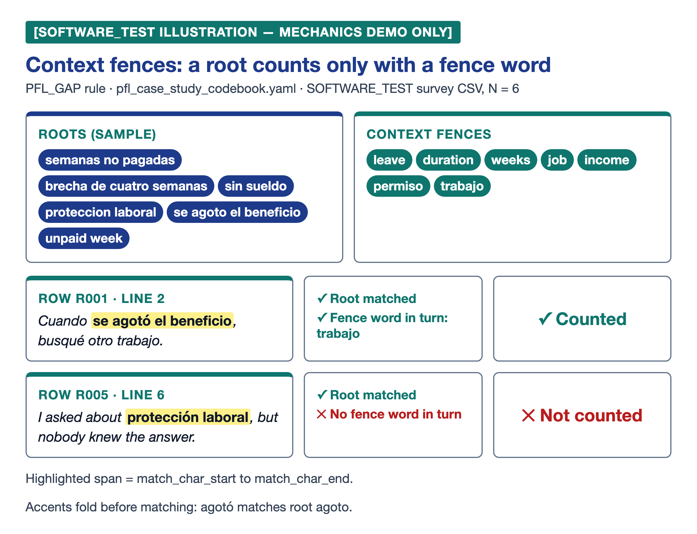

# ATLAS: Methodology & Reference Manual

> Every count, quote, digest and figure in this manual is output of the ATLAS code on the built-in
> `SOFTWARE_TEST` fixtures in `data/samples/`. The fixtures demonstrate software mechanics only and are
> not empirical research findings.

### 1. Purpose

Program evaluation and applied economics often rest on unstructured text: semi-structured interviews,
focus groups, open-ended survey answers and public comments. Qualitative work usually reports themes and
excerpts; quantitative models need counts, proportions and their uncertainty. ATLAS (Automated
Text-to-Ledger Actuarial Synthesis) connects the two. It parses multi-speaker transcripts and response
tables into turns, applies an explicit YAML codebook, counts how many analytical units report each
domain, and keeps a line-level, hash-anchored trail from every number back to the words that produced it.

---

### 2. Framework: inductive discovery, then deductive measurement


*Exhibit 1: Modules and what each adds. Inputs are parsed into turns; discovery and coding run on the
participant turns; exports are verified against a manifest.*

**Inductive discovery (`atlas_discover.discover_topics`).** Grounded approaches start by reading the
material without a fixed frame (Glaser & Strauss, 1967; Charmaz, 2006). ATLAS supports this step with
Latent Dirichlet Allocation (Blei, Ng & Jordan, 2003) over participant turns: unigram and bigram counts
with an English + Spanish stopword list, `n_topics` components (clamped to the number of usable turns),
`random_state=42`. Each term is assigned to the topic where its weight is highest, so top-term lists do
not repeat across topics. Each turn is assigned to its highest-weight topic, and the topic's **medoid**
is the member turn with the highest TF-IDF cosine similarity to the members' TF-IDF centroid (Manning,
Raghavan & Schütze, 2008). The medoid is always a real, verbatim turn. `topics_to_codebook_dict` turns
the topics into a draft `domains` codebook (roots = top terms, no fences) that a coder should review,
rename and fence before using it for measurement.

**Deductive measurement (`AtlasEngine`).** The reviewed themes become an explicit codebook (MacQueen et
al., 1998; Saldaña, 2021). Applying it is deterministic: the same files and codebook give the same counts
on every run, which addresses the coder-drift concern raised in reliability debates (O'Connor & Joffe,
2020) for the measurement step, though not for the judgement that went into the codebook.

---

### 3. Matching rules (`atlas_engine.py`)

**Codebook schemas.** `normalize_codebook_rules` accepts three equivalent layouts: `domains` (fields
`id`, `name`, `roots_en`, `roots_es`, `context_fences`, `context_window`, `exclude_fences`,
`exclude_window`); `topics` as a mapping or list (`label`, `keywords`, `required_context`,
`context_window`); or `themes` followed by `frictions` (`name`, `definition`, `keywords`). Duplicate ids
are rejected. Windows must be nonnegative whole token counts; anything else (`-1`, `2.5`, `"8 tokens"`)
raises an error rather than silently changing a rule.

**Roots.** Each root term is compiled as a case-insensitive pattern anchored at a word start, so a root
acts as a stem: `childcare` matches `childcare` and `childcares`, while `trabajo` does not match
`trabajaba`. Overlapping occurrences of different roots are all evaluated.

**Combining-mark folding.** Turn text and terms are folded by decomposing each character with Unicode
NFD and dropping combining marks (category Mn). NFC `ó` and NFD `o` + U+0301 therefore both fold to `o`,
and the root `se agoto el beneficio` matches `se agotó el beneficio`. Characters without a canonical
decomposition (`fi`, `ß`) are kept. Folding keeps an index map, so each match is reported as
`match_char_start` / `match_char_end` in the **original** turn text and `match_text` equals
`text[match_char_start:match_char_end]` exactly.

**Context fences.** If a domain has `context_fences`, a root occurrence counts only when a fence term is
also present in the turn. If `context_window: N` is also set, the fence must lie within N tokens of the
root (the token gap between the two spans is at most N). A `context_window` on a domain without fences
has no effect.

**Exclusion fences.** If a domain has `exclude_fences` and no `exclude_window`, any exclusion term in the
turn vetoes that domain for the turn. With `exclude_window: N`, only root occurrences within N tokens of
an exclusion term are vetoed; other roots in the same turn can still count.

```yaml
domains:
  - id: CHILDCARE
    name: Childcare access
    roots_en: ["childcare"]
    exclude_fences: ["not a problem"]
    exclude_window: 3        # "childcare ... not a problem" within 3 tokens is vetoed
  - id: PROTECCION
    name: Job protection
    roots_es: ["protección laboral"]
    roots_en: ["job protection"]
    context_fences: ["trabajo", "permiso", "leave", "job"]   # no window: fence anywhere in the turn
```

**Mentions.** A turn that matches a domain contributes one quote row (first qualifying span) and one
matching turn; `total_mentions` counts non-overlapping qualifying spans, chosen greedily, so a root nested
inside a longer root counts once.

---

### 4. Units of analysis

* **Turn.** One speaker's contiguous contribution in a transcript, or one non-blank response cell in a
  table. Facilitator turns are excluded from coding: speakers named in `facilitator_names` (matched
  case-, whitespace- and normalization-insensitively), or, when no names are given, a named speaker who
  asked more than half of at least three questions in a transcript. Speakerless turns that match an
  `interviewer_prompt_patterns` regex are excluded too.
* **`source_id`.** One per input file: the POSIX path relative to `root_dir`, or the absolute path when
  no root is given. Two files with the same basename in different folders keep distinct ids.
* **`unit_id`.** One per analytical unit. A transcript is one unit (`unit_id == source_id`), even when
  all its turns are facilitator turns or it parsed to no turns. A table row is one unit:
  `<source_id>::<id>` with an id column, `<source_id>#row_<line>` when that id cell is blank, and
  `<source_id>::row_<line>` when no id column is set. Rows with a blank response are skipped and rows
  flagged as facilitator prompts are not respondents.
* **Prevalence.** `prevalence_pct` = distinct `unit_id`s with at least one matching participant turn ÷
  all analytical units × 100, rounded to one decimal. `matching_turns` counts turns, not units.

---

### 5. SOFTWARE_TEST walkthrough

All tables below are printed by `scripts/generate_docs_figures.py --tables`, which runs the real
modules on `data/samples/`. They are labelled `SOFTWARE_TEST` and show mechanics, not findings.

#### 5.1 SOFTWARE_TEST — survey CSV × `pfl_case_study_codebook.yaml`

Input: `software_test_survey.csv` with `text_col="response"`, `id_col="respondent_id"`,
`speaker_col="role"`. Seven data rows, one blank (R004), so **N = 6 units, 6 participant turns,
5 domains, 1 matched turn**.

| Domain ID | Domain | Units reporting | N | Prevalence (%) | Binomial SE | Matching turns |
| :--- | :--- | ---: | ---: | ---: | ---: | ---: |
| `PFL_GAP` | Job Protection & Leave Duration Gap | 1 | 6 | 16.7 | 0.152 | 1 |
| `PFL_REPLACE` | Replacement Worker & Cross-Training Overhead | 0 | 6 | 0.0 | 0.000 | 0 |
| `PFL_WAGE` | Wage Replacement Sufficiency & Low-Wage Take-Up | 0 | 6 | 0.0 | 0.000 | 0 |
| `PFL_PORTAL` | Administrative Portal & Certification Delays | 0 | 6 | 0.0 | 0.000 | 0 |
| `PFL_STIGMA` | Workplace Stigma & Informal Retaliation | 0 | 6 | 0.0 | 0.000 | 0 |

Quote inventory (SOFTWARE_TEST):

| Domain | `unit_id` | Line | Speaker | Span | `match_text` | `source_sha256` (first 12) | Verbatim turn |
| :--- | :--- | ---: | :--- | :---: | :--- | :--- | :--- |
| `PFL_GAP` | `data/samples/software_test_survey.csv::R001` | 2 | participant | 7–28 | se agotó el beneficio | `02a7a3c8239a` | Cuando se agotó el beneficio, busqué otro trabajo. |


*Exhibit 2 (SOFTWARE_TEST): `PFL_GAP` has context fences and no window. R001 contains a root and the
fence `trabajo`, so it counts. R005 contains the root `protección laboral` but no fence term, so it does
not; with the fences removed the same rule matches R005 as well.*


*Exhibit 3 (SOFTWARE_TEST): prevalence by domain for the table above, with binomial SE.*

#### 5.2 SOFTWARE_TEST — bilingual interview `.txt` + Zoom `.vtt` × `pfl_case_study_codebook.yaml`

Two transcripts, so **N = 2 units**; 10 turns parsed, 8 participant turns after facilitator turns are
removed; **0 matched turns**. María José Pérez says *se agotó el beneficio en pocas semanas*, but
`semanas` is not a fence and `trabajo` does not match `Trabajaba`; O'Connor mentions *protección
laboral* twice without any fence term. Every domain therefore reports 0 of 2 units (0.0%).

#### 5.3 SOFTWARE_TEST — Teams `.docx` × `intake_and_enrollment.yaml`

One transcript, so **N = 1 unit**, 4 participant turns, 4 domains, 1 matched turn:
`paperwork_delays` at 1 of 1 unit (100.0%) on line 4, span 39–48 (`paperwork`), in the turn
*That covers what I wanted to know. The paperwork took two visits.* With N = 1, the binomial SE is 0.000,
which shows why prevalence on very small N says little.

#### 5.4 SOFTWARE_TEST — topic discovery, k = 3

| Corpus | Topic | Top terms (first four) | Turns (share) | Medoid `unit_id` | Medoid turn |
| :--- | ---: | :--- | :--- | :--- | :--- |
| Survey | 1 | answer, asked, asked protección, knew | 3 (50.0%) | `…survey.csv::R002` | The clinic hours did not match my shift. |
| Survey | 2 | middle, middle month, month, ran | 2 (33.3%) | `…survey.csv::R001` | Cuando se agotó el beneficio, busqué otro trabajo. |
| Survey | 3 | attend, attend honestly, childcare, childcare made | 1 (16.7%) | `…survey.csv::R007` | Childcare made it hard to attend, honestly. |
| Bilingual | 1 | laboral, protección, protección laboral, agotó | 5 (62.5%) | `…bilingual_interview.txt` | For me the protección laboral rules were confusing. Who was supposed to explain them? |
| Bilingual | 2 | evenings, mostly, mostly scheduling, move | 2 (25.0%) | `…zoom_session.vtt` | About a year. Is the survey going to be shared with my caseworker? |
| Bilingual | 3 | year, changed, changed year, evaluation | 1 (12.5%) | `…zoom_session.vtt` | No, it stays with the evaluation team. What changed for you this year? |

With six or eight short turns, LDA topics mostly reflect which words co-occur in single sentences; the
table shows the mechanics (term ownership, medoid selection), not themes.

---

### 6. From counts to parameters: the ledger export

`AtlasEngine.export_results(results, output_dir)` writes:

* `thematic_frequencies.csv` and `verbatim_quotes_inventory.csv` / `.parquet`;
* `actuarial_parameter_matrix.xlsx` with an **Empirical Frequencies** sheet (domain id and name, units
  reporting, total units, prevalence, matching turns, plain-language statement) and a **Verbatim Quotes
  & Provenance** sheet (domain, `source_id`, `unit_id`, line, timestamp, speaker, match start/end,
  verbatim text, source SHA-256);
* `provenance_manifest.json` with the run's counts, per-domain values and `audit_sha256`, and the
  SHA-256 of every source file.

Each prevalence cell carries a comment headed `ATLAS VERIFICATION AUDIT STAMP` with the domain, counts
and a digest of `domain_id | units reporting | total units | matching turns | prevalence | sorted source
SHA-256s`. `AtlasEngine.verify_workbook_integrity(xlsx, manifest)` recomputes prevalence, digests and
statements from the manifest and compares them with every cell of the frequency sheet, including the
comment; any edit is reported as a reason. It does not re-verify the quote sheet or re-hash source files.

For the SOFTWARE_TEST survey run the `PFL_GAP` comment reads `Documents: 1 / 6`, `Matching Turns: 1`,
`Verification SHA-256: 821bd24c51ea…`, and the integrity check passes.


*Exhibit 4 (SOFTWARE_TEST): from verbatim span and file hash to frequency row, audit-stamp comment and
integrity check.*

**Uncertainty.** The workbench's Tab 2 reports, for each domain, p = units reporting ÷ N, the binomial
standard error SE = √(p(1 − p)/N) on the proportion scale, and a normal-approximation 95% interval
p ± 1.96·SE clipped to [0, 1]. This treats units as independent draws, and the approximation is poor for
small N or p near 0 or 1. With the 6-unit fixture above, SE = 0.152 around p = 0.167. Analysts feeding
these values into a model should choose an interval suited to their N.

---

### 7. Workbench and accessibility

`app.py` runs every step above live on the selected corpus and codebook: KPI cards, prevalence chart and
table, quote browser, topic discovery with codebook download/apply, parameter matrix and engine-generated
downloads. It loads no remote assets. Text uses navy `#1E3A8A` (10.4:1 on white) and teal `#0F766E`
(5.5:1 on white), and every chart has a table alongside it.


*Exhibit 5 (SOFTWARE_TEST): sidebar controls, KPI values for the survey sample, and the export files.*

---

### 8. Scope and limits

* Roots are lexical stems. Synonyms, paraphrase, negation not covered by an exclusion fence, and
  sarcasm are not detected; codebooks should be piloted against real turns and revised.
* Determinism covers measurement, not codebook design. Different codebooks give different counts.
* Prevalence counts units that *mention* a domain, not how many experienced it.
* Parsing relies on recognisable speaker labels; unusual transcript layouts should be checked in the
  quote browser before counts are reported.

---

### 9. References

1. **Blei, D. M., Ng, A. Y., & Jordan, M. I. (2003).** *Latent Dirichlet Allocation.* Journal of Machine Learning Research, 3, 993–1022. https://jmlr.org/papers/v3/blei03a.html
2. **Charmaz, K. (2006).** *Constructing Grounded Theory: A Practical Guide through Qualitative Analysis.* SAGE Publications.
3. **Glaser, B. G., & Strauss, A. L. (1967).** *The Discovery of Grounded Theory: Strategies for Qualitative Research.* Aldine Publishing.
4. **MacQueen, K. M., McLellan, E., Kay, K., & Milstein, B. (1998).** *Codebook development for team-based qualitative analysis.* Cultural Anthropology Methods, 10(2), 31–36. https://doi.org/10.1177/1525822x980100020301
5. **Manning, C. D., Raghavan, P., & Schütze, H. (2008).** *Introduction to Information Retrieval.* Cambridge University Press. https://doi.org/10.1017/CBO9780511809071
6. **O'Connor, C., & Joffe, H. (2020).** *Intercoder reliability in qualitative research: Debates and practical guidelines.* International Journal of Qualitative Methods, 19, 1–13. https://doi.org/10.1177/1609406919899220
7. **Saldaña, J. (2021).** *The Coding Manual for Qualitative Researchers* (4th ed.). SAGE Publications.
