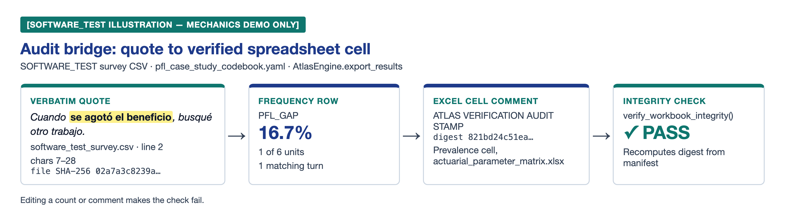

# ATLAS Practitioner Field Guide
## Writing Clear Program Evaluations with Community Voices

**Victoria Cholette**  
*Open ATLAS Toolkit for Community Programs and Applied Evaluation*

---

## 1. Communicating Program Value

Community programs do important work every day. They connect families to healthcare, food, and job training. At grant renewal time, funders ask a central question:  
**"Did the program achieve its intended impact, and what evidence supports that conclusion?"**

This guide demonstrates how to use data from interviews, surveys, and intake forms to write evaluation reports that communicate program value clearly.

Direct participant quotes are powerful: they give human voice to key themes and show what program services feel like on the ground. Pairing those quotes with statistics helps funders understand how widespread those experiences really are. Together, quotes and numbers provide both the human story and the evidence of scale.

---

## 2. How Evaluators Report Findings (And Where Information Gaps Emerge)

Evaluation reports draw on many sources of community feedback. These include intake notes, focus groups, and survey comments.

When summarizing this qualitative feedback, it is common and reasonable to write statements like this:

> *"Participants reported that clinic hours helped, while several families faced travel barriers and paperwork delays."*

This statement is accurate and reflects real staff observations. But funders and review teams face clear information gaps when reading general descriptions:

* **Scope and Prevalence:** Did the problem affect 3 people out of 50, or 35 people? Without a clear count, funders cannot tell if the issue was an isolated case or a widespread barrier.
* **Mechanism:** What part of the system broke down? Was it bus schedules, gas costs, or appointment times?
* **Accountability:** Funders want to know how the theme was identified and whether counter-examples were reviewed.

When reports pair direct quotes with exact counts and percentages, those gaps disappear. Funders see both the depth of the story and its true scale.

---

## 3. Two Ways to Learn from Stories: Inductive and Deductive Evaluation

Program evaluation uses two main ways of thinking: **inductive reasoning** and **deductive reasoning**. Strong evaluation reports use both.

```
+--------------------------------------------------------+
|                   COMMUNITY DATA                       |
|    (Interviews, Survey Responses, Program Notes)       |
+---------------------------+----------------------------+
                            |
              +-------------+-------------+
              |                           |
              v                           v
    [INDUCTIVE DISCOVERY]       [DEDUCTIVE MEASUREMENT]
     "Listening to Learn"        "Measuring What Matters"
     * Uncovers surprise needs   * Checks defined goals
     * Catches blind spots       * Counts exact frequencies
              |                           |
              +-------------+-------------+
                            |
                            v
              [EVALUATION REPORT EVIDENCE]
              Human Context  +  Verified Scale
```

### Inductive Reasoning ("Listening to Learn")
Inductive evaluation starts with an open mind. Instead of checking fixed boxes, the evaluator reads community notes to find surprise patterns.

* **Example:** A nutrition program may assume class attendance is low due to a lack of cooking tools. Through open listening, staff learn that clients work night shifts and cannot attend day classes.
* **The Benefit:** Inductive review catches blind spots that program staff never expected.

### Deductive Reasoning ("Measuring What Matters")
Deductive evaluation starts with clear program goals. The evaluator builds a checklist of key topics and counts how often each topic appears across all notes.

* **Example:** A grant contract requires tracking benefit cliffs. The evaluator searches the notes to count how many workers lost public aid after getting a wage raise.
* **The Benefit:** Deductive review gives exact numbers that match grant goals.

By combining inductive discovery (finding the surprise barriers) with deductive counts (measuring their prevalence), reports become both deep and accurate.

---

## 4. The 2-Step Evaluation Workflow: From Discovery to Measurement

Evaluation teams often face a difficult puzzle:
* If you only count fixed questions, you miss unexpected community needs.
* If you only look at word clouds or open topics, you cannot report clear percentages to funders.

ATLAS bridges the two with a short loop: **discover, then measure**.

```
+-------------------------------------------------------------+
|                      YOUR RAW DATA                          |
|             (Survey comments, interview notes)              |
+------------------------------+------------------------------+
                               |
                               v
+-------------------------------------------------------------+
|        STEP 1: INDUCTIVE DISCOVERY (Tab 1, sub-tab 3)       |
|  * Set the number of topics and read each topic's terms.    |
|  * Read the medoid: the real comment closest to the topic.  |
+------------------------------+------------------------------+
                               |
                               v
+-------------------------------------------------------------+
|        STEP 2: SHAPE THE CHECKLIST (the YAML codebook)      |
|  * Download the discovered codebook (.yaml).                |
|  * Rename topics, drop filler words, add fences.            |
|  * Upload it as a custom codebook.                          |
+------------------------------+------------------------------+
                               |
                               v
+-------------------------------------------------------------+
|             STEP 3: DEDUCTIVE MEASUREMENT                   |
|  * ATLAS codes every response against the checklist.        |
|  * Read counts, percentages and verbatim quotes.            |
+-------------------------------------------------------------+
```

### Step A: Run Inductive Discovery
Load the survey or interview files in the sidebar (**Corpus Dataset → Upload Custom Files**) and open
**Tab 1 → 💡 Unsupervised Topic Discovery (Medoids)**.
* Choose **Number of topics (k)** between 1 and 10.
* Each topic lists its top terms (a word belongs to one topic only), how many responses it covers, and
  its **medoid**, the actual response that best represents the topic.
* For example, a topic might gather *landlord*, *rent*, *deposit* and *eviction*, even if the grant
  only asked about job training.

### Step B: Shape the Checklist
Discovered topics are a starting draft, not a finished checklist:
1. Click **📥 Download Discovered Codebook (.yaml)** and open the file in any text editor.
2. **Name each category** with a label funders recognise (change `name:` to *Housing Security*).
3. **Prune filler words** such as *actually* or *know* from `roots_en`.
4. **Add project terms** (*voucher*, *stipend*) and context fences so a word only counts in the right
   setting.
5. In the sidebar choose **Active YAML Codebook → Upload Custom Codebook (.yaml)** and upload the edited
   file.

For a quick look before editing, **⚡ Apply Discovered Codebook to Engine** codes the corpus with the
raw draft. Raw drafts have no fences, so their counts are exploratory only.

### Step C: Report Verified Percentages
With the edited codebook active, ATLAS codes every response:
* Tab 1 shows how many units mention each theme and every matching quote with its line and file hash
  (for example, *"34 of 50 families (68.0%) mentioned Housing Security"*; illustrative numbers).
* Tab 2 adds the standard error and the downloadable workbook, manifest and quote list. Keep the
  `.yaml` codebook with the report so others can see exactly what was counted.

---

## 5. How ATLAS Supports Both Approaches (Local and Confidential)

ATLAS (Automated Text-to-Ledger Actuarial Synthesis) is a free tool built for this dual evaluation workflow.

### Local Processing and Data Confidentiality
Protecting community participant confidentiality is essential. Many commercial cloud tools transmit qualitative notes over the internet to remote servers, which can conflict with organizational data-handling protocols or participant consent agreements.

**ATLAS executes locally on your workstation.** Transcript files remain on your local disk during analysis without being transmitted across external cloud APIs (subject to the security of your local operating system and storage environment). ATLAS shows its results in a local web page; on a shared network, start it with `--server.address=localhost` so other computers cannot open that page (see [Privacy and network use](../README.md#privacy-and-network-use)).

### The ATLAS Evaluation Engine
1. **Surfacing Emergent Patterns (Inductive):** ATLAS groups high-frequency word patterns to help evaluators identify unanticipated themes without pre-filtering.
2. **Context-Fenced Measurement (Deductive):** Evaluators define an explicit keyword checklist. ATLAS identifies matching dialogue turns and calculates prevalence using case- and accent-insensitive word-start matching, optional context fences (such as counting *"delay"* only when *"bus"* or *"transit"* appears in the same turn, or within a set number of words), and optional exclusion fences that veto false matches.
3. **Audit Receipts & Verbatim Provenance:** For every matching quote, ATLAS records the source document name, speaker label, timestamp, line number, character span, and the source file's SHA-256 cryptographic digest. This allows evaluators to verify authentic verbatim excerpts against the original transcripts without paraphrasing.

### Methodological Boundaries: Deterministic Execution and Generative AI

Community evaluation teams often ask whether analyzing qualitative transcripts requires commercial artificial intelligence subscriptions or cloud language models. In ATLAS, **the core analytical workflow executes entirely through local, deterministic algorithms.**

Separating qualitative vocabulary ideation from deterministic measurement addresses three practical evaluation considerations:

1. **Local Data Handling:** ATLAS processes transcript files directly on the user's workstation. Transcripts and participant identifiers are not transmitted across external networks or third-party cloud APIs during analysis (subject to the security of the local workstation and storage environment).
2. **Verbatim Quote Provenance:** Rather than relying on a generative model that may summarize or paraphrase participant remarks, ATLAS uses deterministic pattern matching. It extracts the authentic, unedited dialogue spoken by participants, pairing every excerpt with its source file name, speaker label, timestamp, line number, character span, and source file SHA-256 digest.
3. **Reproducible Measurement:** Executing the same codebook across the same corpus yields identical counts and percentages on every run. Funders, boards, and research partners can review matching dialogue turns and document prevalence without run-to-run stochastic variation.

#### The Role of Generative AI: Upstream Vocabulary Ideation
Generative models can serve an optional, strictly upstream role during initial evaluation design:
* **Upstream Synonym Discovery:** Evaluators may find large language models useful during initial codebook drafting to brainstorm synonyms, regional terminology, or colloquial phrasing (for example, generating candidate terms for transportation hurdles or enrollment paperwork).
* **Local Processing:** Once candidate keywords are selected, vetted by evaluators, and saved into a YAML codebook, ATLAS performs all keyword searching, context-window filtering, quote extraction, and frequency calculations locally on your workstation.
* **Confidentiality Precaution:** To protect community member confidentiality, never upload raw interview transcripts or identifiable participant narratives to third-party cloud services. Reserve external tools for abstract vocabulary brainstorming, and process authentic qualitative records locally.

#### Unit of Analysis: Dialogue Turns and Documents
ATLAS reports findings across two defined units of measurement:
1. **Dialogue Turns:** The number of individual spoken conversational blocks that match a theme.
2. **Unit Prevalence:** The number and percentage of analytical units in which a theme appears. Each transcript file is one unit and each survey row is one unit. When each transcript records one participant, unit prevalence corresponds to participant prevalence.

---

## 6. Setting Up an Evaluation Checklist (The Codebook)

To measure program goals deductively, staff organize their core questions into a checklist of 3 to 5 topics.

Below is an evaluation checklist for a community health navigation initiative:

| Domain | Evaluation Target | Words and Context Rules |
| :--- | :--- | :--- |
| **Transit Access** | Travel barriers causing missed clinic visits | bus, transit, route, ride, late, schedule |
| **Intake Burden** | Paperwork delays during program signup | forms, documentation, pay stub, verification, delay |
| **Benefit Cliffs** | Loss of public aid after modest wage gains | cliff, threshold, medi-cal, cal fresh, lost coverage |
| **Staff Support** | Positive rapport and care from navigators | navigator, listened, advocate, patient, answered |

In ATLAS, staff type these words into a plain text file. The tool scans every transcript against this list, producing an evidence table in seconds.

---

## 7. Writing the Evaluation Section: 4 Core Elements

Evaluation summaries achieve the greatest clarity when organized into four structured elements:

1. **The Context:** State the specific community barrier or service condition being studied.
2. **The Program Activity:** Describe what the program did to help.
3. **The Evidence (Counts Paired with Quotes):** State the exact count and percentage from the data, followed immediately by a direct quote that shows the human reality.
4. **The Action Plan:** Explain the operational change or shift in resources the team will make in response to what was learned.

---

## 8. Writing Models: From General Descriptions to Verifiable Findings

The following models illustrate how general qualitative descriptions transform into structured, verifiable evaluation findings.

> **Hypothetical writing models.** The counts, quotes and line numbers in Models 1 and 2 are invented to
> show sentence structure. They are not ATLAS output and not findings. For real ATLAS output on the
> built-in `SOFTWARE_TEST` fixtures see the [Methodology & Reference Manual](ATLAS_Methodology_and_Reference_Manual.md#5-software_test-walkthrough).

### Model 1: Transportation Barriers

* **General Description:**  
  > *"Transportation continues to be a major obstacle for our community members. Many participants reported that buses were unreliable, which led to missed clinic visits."*

* **Verifiable Evaluation Narrative:**  
  > *"Transportation barriers directly affected clinic attendance across the cohort. Out of 45 individual interview transcripts (where each transcript records a 1:1 participant interview), 29 documents (64.4%) reported that transit delays caused them to arrive late or miss scheduled medical appointments across 38 matching dialogue turns. As one participant explained:  
  > 'The cross-town bus only runs once an hour. If an appointment is at 9:00 AM, my family has to leave home before 7:00 AM, and any transfer delay causes a missed visit' (Intake Log, Line 114).  
  > In response to this measured prevalence, the program shifted funds to provide guaranteed ride-share vouchers for morning specialty visits."*

### Model 2: Enrollment Administrative Friction

* **General Description:**  
  > *"Participants expressed appreciation for navigator staff, although paperwork requirements created frustration during the initial enrollment period."*

* **Verifiable Evaluation Narrative:**  
  > *"Participant feedback reflected strong satisfaction with staff navigation alongside measurable paperwork delays during onboarding. Across 45 individual interview transcripts (one per participant), 41 documents (91.1%) recorded positive, respectful interactions with community navigators, while 16 documents (35.6%) noted that assembling three consecutive months of pay stubs delayed enrollment by more than two weeks. One participant noted:  
  > 'Finding old pay stubs from two past jobs took three weeks, during which my application sat waiting' (Interview 08, Line 62).  
  > Based on these findings, the team updated the intake protocol to permit self-attestation for seasonal income, cutting onboarding time from 18 days to 4 days."*

---

## 9. Verifying Evaluation Findings: The Audit Receipt

Funders and evaluation monitors want to know that numbers and quotes are real.

ATLAS creates an automated proof sheet for every run:

1. **Digital Fingerprint (SHA-256 Code):** A cryptographic hash that enables reviewers to verify whether local source files match retained reference versions.
2. **Transcript Line References & Character Spans:** Every cited quote lists its transcript line number and turn character span, allowing an evaluator to locate the excerpt within the interview record.
3. **Deterministic Reproducibility:** Because ATLAS applies fixed matching rules rather than a probabilistic language model, re-running the same codebook on the same files yields identical counts and percentages every time.
4. **Workbook Check:** Each prevalence cell in the Excel export carries an audit-stamp comment, and ATLAS re-checks the workbook against its provenance manifest; the result is shown in Tab 2.


*SOFTWARE_TEST illustration of the audit trail on a built-in sample; mechanics only.*

Attaching this proof sheet to a grant report protects the agency and builds long-term funder trust.

---

## 10. Evaluation Report Pre-Flight Checklist

Before submitting an evaluation report, grant renewal, or board update, verify that each section satisfies these standards:

- [ ] **Dual Grounding:** Does every major qualitative claim pair a concrete statistic (count and percentage) with an illustrative quote?
- [ ] **Denominator Clarity:** Are sample sizes and measurement units stated explicitly (e.g., *"29 of 45 individual interview transcripts (64.4%)"*, distinguishing matching dialogue turns from document prevalence)?
- [ ] **Inductive & Deductive Balance:** Does the report capture both planned contract targets and unexpected community findings?
- [ ] **Operational Action:** Does each identified barrier connect to a clear next step or program change?
- [ ] **Source Receipts:** Are all quoted excerpts traceable to specific transcript line numbers?
- [ ] **Confidentiality:** Are individual names and personal details removed from public deliverables?
- [ ] **Audit Attachment:** Is the ATLAS proof sheet included in the report appendix?

---

## Appendix: How to Develop an Evaluation Codebook

A **codebook** is the master checklist for an evaluation project. It tells ATLAS exactly what words to count, which topics belong together, and what to ignore.

Developing a codebook does not require computer programming. You can start from discovered topics inside ATLAS (Option A) or write one step by step (Option B).

### Option A: Start from Discovered Topics in ATLAS

1. **Load Your Data:** In the sidebar choose **Corpus Dataset → Upload Custom Files** and add CSV, Excel or transcript files. For tables, check that the **Text column** selector shows the free-text column.
2. **Run Discovery:** Open **Tab 1 → 💡 Unsupervised Topic Discovery (Medoids)** and choose the number of topics.
3. **Download the Draft:** Click **📥 Download Discovered Codebook (.yaml)**.
4. **Name Your Categories:** In a text editor, change each `name:` to a clear program title (for example, `Transportation Barriers`).
5. **Prune General Words:** Delete entries from `roots_en` that are not specific to that goal, and add context fences.
6. **Load and Score:** Choose **Active YAML Codebook → Upload Custom Codebook (.yaml)** and upload the edited file. Every response is scored immediately.

### Option B: Build a Custom Codebook Step-by-Step

Here is a 5-step process to build a reliable codebook:

### Step 1: Start with Grant Goals and Community Notes
A sound codebook connects grant requirements with authentic community language.
* **Review Contract Deliverables:** List the 3 to 5 core outcomes required by funders (such as job placement, food security, or clinic visits).
* **Scan Initial Transcripts:** Read 5 sample interview or survey notes to note the everyday words community members actually use. For example, people might say *"ran out of food"* instead of *"food insecure"*.

### Step 2: Define Each Topic Clearly
Every topic needs a plain definition so team members agree on what belongs in that category.
* **Topic Name:** Transit Barriers
* **Definition:** Any mention where travel problems caused a client to miss, arrive late, or struggle to reach an appointment.
* **What Counts:** Bus delays, broken cars, high fares, long walks.
* **What Does Not Count:** General discussions about road construction unrelated to appointment attendance.

### Step 3: Build the Word List (Inclusions and Exclusions)
A strong codebook uses two types of word rules:
1. **Inclusion Words (Words that count):** Words that signal the topic.
   * *Example for Transit:* `bus`, `transit`, `train`, `ride`, `car trouble`, `fare`, `late`
2. **Exclusion Rules (Words that do not count):** Words that prevent false matches.
   * *Context rule:* The word *"ride"* might appear in a conversation about an amusement park. A context fence (`required_context` or `context_fences`, with `context_window: 10`) makes *"ride"* count only within 10 words of terms like *"doctor"*, *"clinic"*, or *"job"*.
   * *Exclusion rule:* An exclusion fence (`exclude_fences`, optional `exclude_window`) vetoes a match, for example *"childcare"* followed by *"not a problem"*.

### Step 4: Pilot Test on Five Transcripts
Before running ATLAS on the full dataset, test the codebook on five sample files:
1. Run ATLAS using the initial keyword list.
2. Review the resulting quotes in the Evidence Table.
3. Check for two common issues:
   * **Missed Matches:** Did a client describe a barrier using words not yet on the list? (If so, add those words).
   * **False Matches:** Did ATLAS count a quote that does not fit the goal? (If so, add an exclusion rule).

### Step 5: Save as a Plain Text File (YAML Format)
ATLAS reads codebooks saved as plain-text YAML files (`.yaml` or `.yml`). It accepts two equivalent layouts:
1. **Practitioner Format (shown below):** Uses `topics`, with `keywords`, `context_window` (maximum token distance), and `required_context` (context fences).
2. **Researcher Format:** Uses `domains`, with `roots_en`, `roots_es`, `context_fences`, `context_window`, `exclude_fences`, and `exclude_window`.

The local engine (`atlas_engine.py`) normalizes both layouts into the same rules. Words match at the start of a word, ignoring capital letters and accents. A `context_window` only applies when context words are listed.

Below is a complete, copy-pasteable example of an evaluation codebook for a family support program:

```yaml
# Family Support Program Evaluation Codebook
program_name: "Community Health and Navigation"
version: "1.0"

topics:
  transit_access:
    label: "Transportation Barriers"
    description: "Difficulties traveling to appointments or work"
    keywords:
      - "bus"
      - "transit"
      - "route"
      - "no ride"
      - "car trouble"
      - "fare"
    context_window: 10
    required_context:
      - "clinic"
      - "doctor"
      - "visit"
      - "job"
      - "appointment"

  paperwork_delays:
    label: "Enrollment & Paperwork Friction"
    description: "Administrative delays during program intake"
    keywords:
      - "forms"
      - "documentation"
      - "pay stubs"
      - "proof of income"
      - "verification"
      - "delayed"
    context_window: 8
    required_context:
      - "intake"
      - "application"
      - "sign up"
      - "enrollment"
      - "weeks"

  staff_advocacy:
    label: "Staff Navigation & Support"
    description: "Positive support and navigation provided by staff"
    keywords:
      - "navigator"
      - "advocate"
      - "patient"
      - "listened"
      - "helped me"
      - "clear answers"
    context_window: 6
    required_context:
      - "clinic"
      - "staff"
      - "caseworker"
      - "office"
      - "appointment"
```

### Where to Find Pre-Built Topic Libraries

Staff do not need to create topic lists from scratch. Several free, public libraries offer proven categories, clear definitions, and word ideas:

1. **The 2-1-1 Community Needs Directory ([211taxonomy.org](https://211taxonomy.org)):**
   * *What it is:* The national standard used by community help hotlines across North America.
   * *What to borrow:* Clear names and definitions for over 10,000 community needs, such as rent help, food pantries, bus passes, and utility bills.

2. **The PRAPARE® Community Clinic Tool ([prapare.org](https://prapare.org)):**
   * *What it is:* A top tool used by health clinics nationwide to track social needs.
   * *What to borrow:* Proven topics for housing stress, food needs, transit hurdles, and clinic paperwork.

3. **The IRIS+ Impact Catalog ([iris.thegiin.org](https://iris.thegiin.org)):**
   * *What it is:* A large library of social goals managed by the Global Impact Investing Network.
   * *What to borrow:* Goal lists for youth programs, schooling, health access, and family nutrition.

4. **The O*NET Job Skills System ([onetonline.org](https://www.onetonline.org)):**
   * *What it is:* A public tool from the U.S. Department of Labor.
   * *What to borrow:* Clear word lists for job training, work tasks, and workplace hurdles.

5. **ATLAS Starter Packs (In the Open-Source Repository):**
   * Pre-made codebook files live in the ATLAS `config/` folder:
     * `sdoh_basic_needs.yaml`: Covers housing, transit, food, and utilities.
     * `intake_and_enrollment.yaml`: Covers paperwork delays, wait times, and sign-up rules.
     * `workforce_and_mobility.yaml`: Covers benefit cliffs, career goals, and job shifts.
     * `youth_and_family.yaml`: Covers school attendance, family talks, and staff support.

#### How to Use a Public Library in 3 Steps:
1. **Pick the Topic:** Find the matching topic in the public library, like PRAPARE's *Transportation Access*.
2. **Copy the Definition:** Paste the public text into the codebook `description` line so all staff agree on what it means.
3. **Add Spoken Words:** Add the everyday words people use in interviews (`bus`, `route 4`, `flat tire`, `late`) and set your context rules.

### Codebook Quality Checklist
Before running a final evaluation, confirm:
- [ ] Are topics limited to 3 to 5 clear domains?
- [ ] Does each topic have a plain-English definition?
- [ ] Are keywords drawn from real participant language rather than academic jargon?
- [ ] Were rules tested on at least five sample transcripts?
- [ ] Did another team member review the definitions for clarity?

---

*ATLAS is open-source software distributed under the MIT License. Documentation, sample codebooks, and implementation guides are available at [github.com/dphdame/atlas](https://github.com/dphdame/atlas).*
