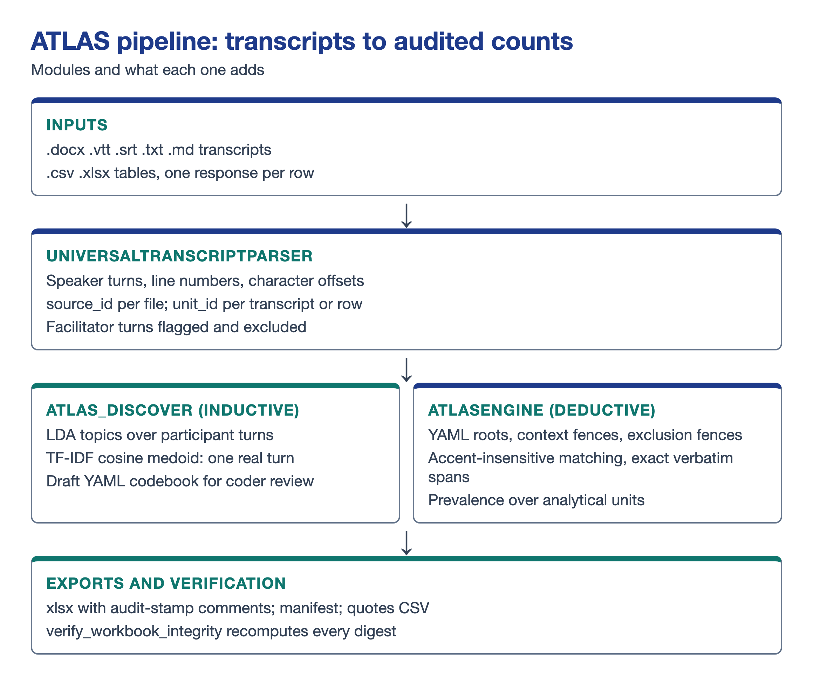
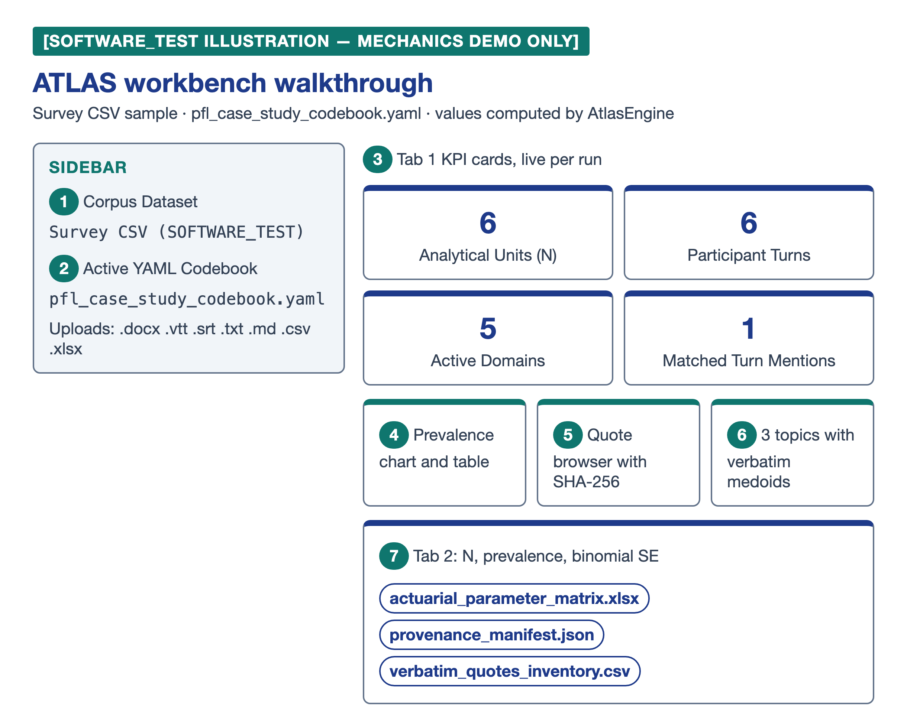
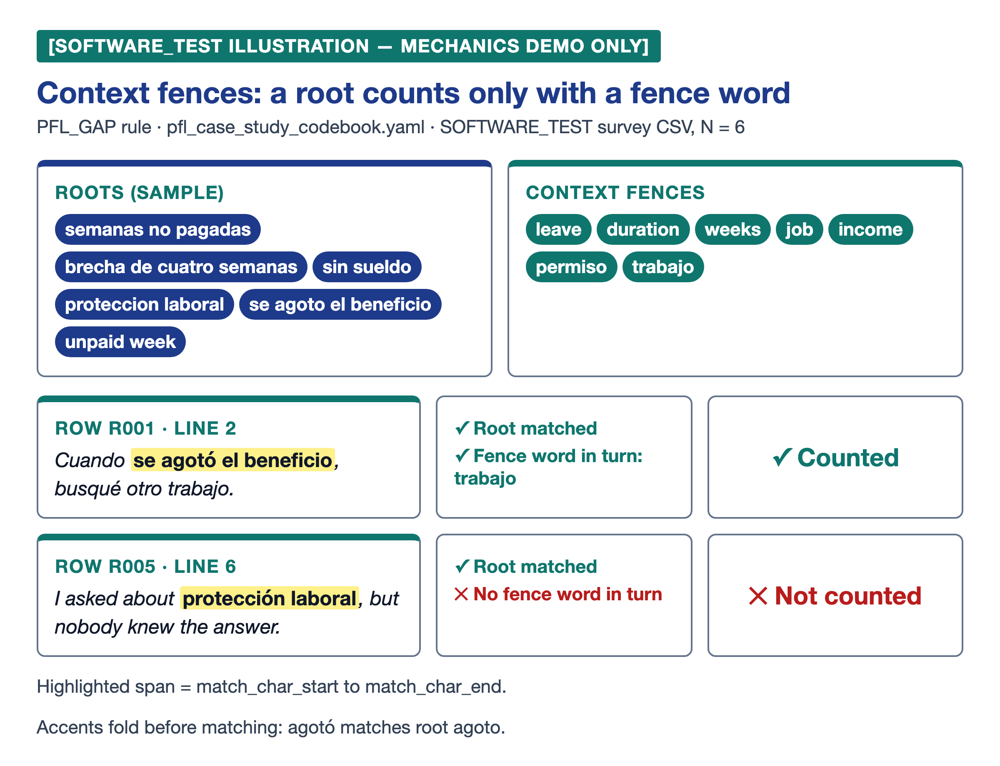
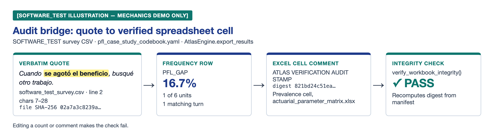

# ATLAS User Guide
## Automated Text-to-Ledger Actuarial Synthesis: the local workbench (`v1.2`)

**ATLAS is a local qualitative coding and topic-discovery workbench that turns transcripts, 3-column Word focus-group notes, and open-ended survey tables into line-auditable counts and verified exports.** Every step runs on your own machine using deterministic keyword rules and local topic models, so participant text stays private and repeated runs with the same files and theme rules always produce the exact same counts.

> Examples in this guide use the built-in `SOFTWARE_TEST` fixtures in `data/samples/`. They demonstrate
> software mechanics only; no number here is a research finding.

---

## Table of Contents

1. [What ATLAS does](#1-what-atlas-does)
2. [Installing and launching](#2-installing-and-launching)
3. [Preparing data (notes, Excel surveys, and audio transcripts)](#3-preparing-data-notes-excel-surveys-and-audio-transcripts)
4. [The sidebar](#4-the-sidebar)
5. [Themes & Quotes tab](#5-themes--quotes-tab)
6. [Exports & Audit Files tab](#6-exports--audit-files-tab)
7. [Reference Guides tab](#7-reference-guides-tab)
8. [Writing and customizing a YAML theme file](#8-writing-and-customizing-a-yaml-theme-file)
9. [Troubleshooting](#9-troubleshooting)
10. [Glossary](#10-glossary)

---

## 1. What ATLAS does

Qualitative analysis often breaks down at the handoff between reading text and reporting numbers: hand-coded spreadsheets drift across sessions, while black-box AI summaries lose line-level traceability. ATLAS resolves that gap by separating parsing, theme discovery, deterministic coding, and cryptographic verification into four linked steps:

* **Parses transcripts, 3-column focus-group notes, and survey tables into entries.** Each parsed entry records its speaker, source file, line number, character offsets, and—for structured focus-group notes—its source type (verbatim quote, paraphrased key point, or note-taker observation).
* **Codes participant entries against transparent keyword rules.** After excluding facilitator prompts, question headers, and consent lines, ATLAS matches each remaining entry against root terms (using word-start prefix matching or strict whole-word `match_mode: exact`), optional context fences, optional exclusion fences, and optional bounded spelling tolerance for open-ended surveys.
* **Measures prevalence on the right denominator.** In Individual Mode, ATLAS counts analytical units (one per transcript or survey respondent unit) and reports Binomial standard errors. In Group Mode (chosen automatically for 3-column focus-group notes), ATLAS counts focus groups (`1 file = 1 group`), displays a uniform Group × Theme presence grid alongside notes volume, and hides normal-approximation Binomial intervals that are invalid for small, clustered groups.
* **Discovers unlisted themes offline and flags spot-check risks.** ATLAS defaults to **TF-IDF + NMF** clustering (with classic **LDA** selectable inside **Method settings**), shows how many entries in each cluster matched none of your active themes, lets you append a discovered cluster to your active themes in one click, and includes **Spot-Check Matches** to flag partial-word matches, spelling-tolerance rescues, and nearby negations.
* **Exports printable reports, verified spreadsheets, and audit manifests.** ATLAS generates a full Word summary report (`atlas_summary_report.docx`), an Excel workbook whose prevalence cells carry `ATLAS VERIFICATION AUDIT STAMP` comments, a JSON provenance manifest with source-file SHA-256 hashes, and separate CSV quote/evidence inventories, verifying workbook integrity automatically before download.

ATLAS does **not** paraphrase, summarize, translate, rewrite quotes, or score sentiment. ATLAS code makes no network requests and the page loads no remote assets; see [Privacy and network use](../README.md#privacy-and-network-use) for what Streamlit and the operating system do around it.



---

## 2. Installing and launching

You do not need to install packages manually or configure Python paths. Each desktop launcher checks for Python 3.10+, builds a local `.venv` folder inside the `atlas` directory, installs `requirements.txt` only when `.venv` is missing or dependencies changed, verifies core imports, and opens the app at `http://localhost:8501`.

* **macOS / Linux:** Double-click `run.command` (or run `bash run.command` in Terminal).
* **Windows:** Double-click `run.bat`.
* **Verify setup without launching the browser:** Run `./run.command --check-only` or `run.bat --check-only` (or set `ATLAS_NO_LAUNCH=1`) to provision and verify `.venv`, then exit cleanly.
* **Localhost-only by default:** Both desktop launchers pass `--server.address=localhost` and `--browser.gatherUsageStats=false`, so Streamlit binds strictly to your machine's loopback interface (unreachable from other devices on a shared Wi-Fi or office network) and disables usage statistics. If you launch from the command line manually, keep both flags:
  `.venv/bin/streamlit run app.py --server.address=localhost --browser.gatherUsageStats=false`.

---

## 3. Preparing data (notes, Excel surveys, and audio transcripts)

ATLAS reads six common qualitative file formats without requiring reformatting into a proprietary schema. Because the parser preserves exact line numbers and character positions, keep original files clean and strip unnecessary personal identifiers before uploading.

| Format | How ATLAS reads it |
| :--- | :--- |
| `.txt`, `.md` | One turn per speaker label such as `Name [00:01:12]: text` or `Name: text`. |
| `.vtt`, `.srt` | Caption cues from Zoom, Teams, or video tools; `<v Speaker>` voice tags or `Speaker:` prefixes identify speakers. |
| `.docx` (ordinary transcripts) | Paragraphs or speaker/text tables, including Microsoft Teams exports with multi-line turns. |
| `.docx` (3-column focus-group notes) | Tables with `Key Points`, `Notable Quotes`, and `Observations` columns (in any order). Session headers, consent rows, prompts (`Question N:`, `Q1:`, `Facilitator:`), and summary boxes are excluded and logged in **Excluded Questions & Session Headers**; note-taker `Themes` rows move into a reference panel. |
| `.csv`, `.xlsx` | One row per survey response; any column layout with a header row; leading `#` comment lines in CSVs are skipped. |

### Open-ended Excel and CSV surveys

You do not need to strip out extra survey columns before uploading an Excel or CSV file.

* **Multi-tab Excel workbooks (`.xlsx`):** When an uploaded workbook contains more than one worksheet, a **Choose Excel tab** selector appears in the sidebar so you can pick the exact tab to code. (If you upload several workbooks with incompatible tab names, ATLAS asks you to upload them one at a time.)
* **Picking the question column:** ATLAS auto-detects the open-ended text column (never choosing `id` or `*_id` columns) under **Open-ended question column to code**, and lets you choose optional **Respondent ID** and **Speaker / role** columns. Code one open-ended question column at a time.
* **Blank rows vs. study response rate:** Blank answers in the selected column are skipped automatically, and ATLAS reports **`X written answers scanned (Y rows left this question blank)`**. Do not confuse that skipped-row count with your study's overall survey response rate—many respondents complete closed-ended questions while leaving an optional comment box blank.
* **Repeated Respondent IDs (for example, longitudinal quarterly surveys):** If the chosen Respondent ID column contains repeated IDs across non-blank rows, ATLAS lets you choose between **Keep each row as its own response (preserves Respondent ID in exports)** (default, keeping every quarterly answer separate while carrying `respondent_id` into CSV exports) and **Combine repeated rows under one Respondent ID (N = unique respondents)**.

### Audio transcripts and speaker labels

Speaker labels help ATLAS separate facilitator questions from participant responses, and let you use the **Filter by speaker** control in **Coded Evidence**. How you get speaker labels depends on how the session was recorded:

* **Virtual meetings (Zoom, Microsoft Teams):** Export the transcript directly from Teams (`.docx` or `.vtt`) or Zoom (`.vtt`). Those exports attach speaker tags automatically because each person joins from their own device.
* **In-person audio recordings:** A single room microphone cannot tell speakers apart unless **speaker diarization** (often called *"identify different speakers"* or *"speaker labels"*) is enabled in your transcription tool—such as Word Online Transcribe, Zoom audio transcription, Otter, or Rev—which outputs `Speaker 1:`, `Speaker 2:`, etc. Before uploading to ATLAS, run a quick Find & Replace in Word to rename the facilitator's label to `Facilitator:` (and optionally replace real names with `P1:`, `P2:`, ... for privacy).
* **5-second visual check before uploading:** Open the transcript and confirm each turn starts with a label like `Facilitator: ...`, `P1: ...`, or `[00:01:12] Speaker 1: ...`.
* **If a transcript has no speaker labels:** ATLAS still parses and codes every paragraph cleanly in both Group Mode (`1 file = 1 focus group`) and Individual Mode (`1 file = 1 unit`), without splitting a single file into separate question units. Use **Advanced transcript filters (optional) → Interviewer prompt patterns** if you want to exclude repeated moderator questions, and inspect a sample export from any third-party meeting-note tool in **Coded Evidence** first because export layouts vary across tools.

**Data protection.** Files stay on your local machine during analysis, but exported Word, CSV, and Excel inventories contain coded participant text. Remove direct names or contact details you do not need before sharing exports.

---

## 4. The sidebar

Every analysis choice lives in the left sidebar and takes effect when you click **`Run Analysis`**.



### 1. Input Data

| Option | Files loaded |
| :--- | :--- |
| Upload Custom Files (.docx, .vtt, .srt, .txt, .md, .csv, .xlsx) | Default on launch: drag in one or more files from your workstation |
| Sample: Multi-Group Focus-Group Notes (.docx) | Built-in 2-group practice notes (`software_test_gbi_group_treatment.docx` + `software_test_gbi_group_control.docx`) |

* **Data Type:** Switches between **Individual transcripts / survey responses** and **Group / summarized notes**. Whenever any uploaded `.docx` contains a 3-column focus-group notes table, ATLAS automatically selects **Group / summarized notes** (`1 file = 1 group`), though you can override it at any time. In Group Mode, **Include Note-Taker Observations** stays unchecked by default.
* **Allow minor spelling typos (useful for open-ended surveys):** Off by default. When checked, ATLAS also catches 1-character typos (Damerau-Levenshtein distance 1) on single-word theme keywords of 5+ letters without altering original quotes, still enforcing all context and exclusion fences, and routing every typo match into **Spot-Check Matches** for human verification.
* **Advanced transcript filters (optional):** Collapsed expander for **Facilitator names** and **Interviewer prompt patterns** on free-form or mixed uploads. Stays hidden when every uploaded file is a 3-column focus-group `.docx` notes table in Group Mode.

### 2. Themes to Code

Instead of a long flat list of filenames, themes live in three compact, collapsible drawers:

* **Core Evaluation Themes (10 of 10 checked by default):** Housing & Rent Stability, Food Security & Basic Needs, Financial Stability/Bills & Debt, Employment, Education & Training, Transportation & Mobility, Childcare & Parenting, Healthcare, Mental Health & Stress Relief, and Legal & Justice—with **Select all** and **Clear** buttons.
* **Optional Add-On Themes (0 of 5 checked by default):** Five non-overlapping program delivery and policy friction themes—**Program Enrollment & Paperwork**, **Benefit Cliffs & Aid Loss**, **Utility Shutoffs & Energy Burden**, **Wait Times & Processing Backlogs**, and **Language & Translation Barriers**.
* **Upload Custom Themes (.yaml):** Upload any custom YAML theme file and choose **Use uploaded themes only** (replaces checked drawers) or **Combine with checked themes above**.

Click **`Run Analysis`** when your files and themes are ready. If you clear every theme without uploading a custom file, ATLAS prompts you to select at least one theme before running. Whenever you customize themes in-app or combine drawers, **Save active themes (.yaml)** appears in the sidebar so you can archive your exact rules.

### Reference Guides (Word `.docx`)

The bottom of the sidebar offers one-click formatted **Word (`.docx`)** downloads for all four guides, generated live from `docs/*.md` so they never fall out of sync.

---

## 5. Themes & Quotes tab

At the top of **Themes & Quotes**, a concise banner explains **How these themes work** (confirming that counts come from transparent keyword rules, not AI-invented topics), followed by a collapsed **View active theme keywords** table and four reconciled KPI cards:

* **Group Mode KPIs:** **Focus Groups** (`1 file = 1 group`), **Themes Found** (`X of Y`), **Notes Entries Scanned** (or **Entries Scanned** for mixed/transcript corpora, with `M matched · U none`), and **Theme Matches** (`1 entry can match 2+ themes`).
* **Individual Mode KPIs:** **Analytical Units**, **Themes Found** (`X of Y`), **Written Answers Scanned** (for surveys) or **Turns Scanned** (for transcripts, with `M matched · U none`), and **Theme Matches**.

### Theme Summary

In **Group Mode**, **Theme Summary** presents three coordinated views:

1. **Which Focus Groups Mentioned Each Theme? (Group × Theme Grid):** Uniform `✓` / `—` grid across every focus group plus a rightmost **Groups** summary column (`g/G`). Toggle **Grid shows** between `Presence (✓ / —)` and `Notes entries per group`, or check **Hide 0-match themes** for focused presentations.
2. **How Often Each Theme Appeared in the Notes:** Horizontal bar chart of matched notes entries sorted highest to lowest and clearly labeled as note volume—not participant headcount.
3. **Theme Summary Table:** Reconciles every count directly (`Verbatim Quotes + Paraphrased Key Points (+ Note-Taker Observations) = Theme Matches`).

In **Individual Mode**, **Theme Summary** shows the horizontal prevalence bar chart (`% of analytical units`, labeled by Theme Matches) paired with an accessible HTML summary and table.

Directly below the table sits the 3-button **Download Results** bar (**Download Full Report (.docx)**, **Download Theme Frequencies (.xlsx)**, **Download Direct Quotes (.csv)**), followed by collapsed verification drawers for **Excluded Questions & Session Headers** (showing every stripped prompt/header) and **Note-Taker Themes Summary (Reference Only)** when present.

### Coded Evidence

Search text, filter by theme or speaker (plus group or question in Group Mode), and inspect each match with its highlighted span, source file, line number, character offsets, and SHA-256 digest. When structured focus-group notes are loaded, every entry carries a clear badge (**Verbatim Quote**, **Paraphrase (Key Point)**, or **Note-Taker Observation**), and **Quotable Verbatim Only** hides all paraphrases and observations so you never misquote a note-taker summary.



### Discover Unlisted Themes

Cluster entries by shared words without using your theme checklist. Choose **Number of clusters (k)** (`1–10`) and optionally switch **Clustering method** inside collapsed **Method settings** (defaulting to deterministic **TF-IDF + NMF**, with classic **LDA** selectable). Each cluster card shows:

* Its **coverage badge** joining strictly one-to-one by entry index (`Mostly Uncoded by Active Themes`, `Partially Uncoded`, or `Mostly Covered by Active Themes`),
* Its exclusive **Top keywords** and **Most representative example** (tagged with its source badge on focus-group notes), and
* A collapsed **View all N entries in Cluster K** table showing every member entry and which active themes (if any) already matched it.

Under **Add a discovered cluster to your active themes**, pick a cluster, give it a clear name, keep **Use exact whole-word matching** checked, and click **Add Theme to Active Themes** to append it and immediately re-code.

### Spot-Check Matches

**Spot-Check Matches** audits every coded match and clearly notifies you that **all flagged matches remain counted in your charts and tables until you exclude them**. Flags are grouped into three plain-English review priorities:

1. **Check First (Partial-Word Match):** A keyword matched inside a longer unrelated word (for example, `car` inside `card`), while ignoring benign plurals and routine inflections on longer stems (`groceries`, `rented`, `evicted`) and keeping short `<= 3`-letter stems (`kid`→`kidding`, `car`→`caring`) strict.
2. **Check First (Spelling Match):** A 1-letter typo rescued when **Allow minor spelling typos** is enabled.
3. **Check in Context (Negation or Short Word):** A negation cue (`not`, `never`, `no`, `without`, `didn't`, including curly Word apostrophes) within 5 words, or a short unfenced prefix keyword.

Right inside **Spot-Check Matches**, click **Exclude Selected Words from Theme** (blocking specific partial-word collisions or spelling matches without affecting unrelated valid hits) or **Switch Theme to Exact Whole-Word Matching**, or download `atlas_spot_check_report.csv`.

---

## 6. Exports & Audit Files tab

**Exports & Audit Files** is organized into two clear sections:

1. **Analyst Downloads:** **Download Full Report (.docx)** (`atlas_summary_report.docx`), **Download Theme Frequencies (.xlsx)** (`actuarial_parameter_matrix.xlsx`), **Download Direct Quotes (.csv)** (`verbatim_quotes_inventory.csv`), and (when structured notes are present) **Download All Coded Entries (.csv)** (`coded_evidence_inventory.csv`).
2. **Audit & Reproducibility Files:** The live workbook integrity banner (`AtlasEngine.verify_workbook_integrity`), **Download Provenance Manifest (.json)**, **Download Active Theme Rules (.yaml)**, optional **Download Spelling-Tolerance Matches Inventory (.csv)** (when spelling tolerance rescued matches), and the collapsed **Source files and SHA-256 digests** table.

In **Individual Mode** (ordinary transcripts and surveys), **Exports & Audit Files** also displays the **Prevalence & Binomial Standard Errors** table and 95% confidence interval chart (`p = units reporting / N`, `Binomial SE = √(p(1 − p)/N)`). On the built-in `SOFTWARE_TEST` survey sample × `pfl_case_study_codebook.yaml`:

| Domain ID | Units reporting | N | Prevalence (%) | Binomial SE | Matching turns |
| :--- | ---: | ---: | ---: | ---: | ---: |
| `PFL_GAP` | 1 | 6 | 16.7 | 0.152 | 1 |
| `PFL_REPLACE` | 0 | 6 | 0.0 | 0.000 | 0 |
| `PFL_WAGE` | 0 | 6 | 0.0 | 0.000 | 0 |
| `PFL_PORTAL` | 0 | 6 | 0.0 | 0.000 | 0 |
| `PFL_STIGMA` | 0 | 6 | 0.0 | 0.000 | 0 |

In **Group Mode** (and whenever structured focus-group notes are loaded), ATLAS shows an explicit statistical guardrail notice and hides Binomial SE and 95% intervals.



---

## 7. Reference Guides tab

**Reference Guides** renders all four guides—the GBI Analyst Quick-Start Guide, this User Guide, the Methodology & Reference Manual, and the Practitioner Field Guide—formatted cleanly inside ATLAS with tables and diagrams displayed inline. Use **Download this guide as Word (.docx)** (or the sidebar buttons) to save printable copies offline.

---

## 8. Writing and customizing a YAML theme file

You can customize rules inside ATLAS (via Core/Add-On drawers, one-click cluster addition, and Spot-Check exclusions) or author a YAML theme file directly in any text editor. Every theme file compiles through the same normalizer in `atlas_engine.py`:

```yaml
project: "Example SOFTWARE_TEST codebook"
match_mode: prefix             # optional default: "prefix" (default) or "exact"
domains:
  - id: TRANSIT
    name: Transit barriers
    match_mode: exact          # optional per-theme override: prevents "car" hitting "card" or "career"
    roots_en: ["bus", "transit", "fare", "car"]
    roots_es: ["autobús", "transporte"]
    context_fences: ["appointment", "clinic", "cita"]
    context_window: 8          # fence within 8 tokens of the root
  - id: CHILDCARE
    name: Childcare access
    roots_en: ["childcare"]
    exclude_fences: ["not a problem"]
    exclude_window: 3          # veto roots within 3 tokens of the exclusion
```

* **Prefix vs. exact matching:** By default (`match_mode: prefix`), roots match case- and accent-insensitively at word starts (`evict` matches `eviction`; `autobus` matches `autobús`). Setting `match_mode: exact` at the file or theme level enforces whole-word boundaries on both ends.
* **Context fences:** A rule with `context_fences` counts a root only when a fence term also appears in the entry (or within `context_window` tokens when set).
* **Exclusion fences:** An exclusion fence without `exclude_window` vetoes the theme for the whole entry. With `exclude_window: 0`, it vetoes only matches overlapping that exact word (ideal for excluding `card` or `career` on stem `car` without blocking a genuine `car` elsewhere in the sentence); with `exclude_window: N`, it vetoes roots within `N` tokens of the excluded phrase.
* **Equivalent schemas:** ATLAS accepts `domains`, `topics`, and `themes` + `frictions`. Inspect `config/gbi_focus_group_starter.yaml` and `config/optional_delivery_addons.yaml` for ready-to-adapt templates, and see the [Methodology & Reference Manual](ATLAS_Methodology_and_Reference_Manual.md) for the complete specification.

---

## 9. Troubleshooting

| Message or symptom | Cause and fix |
| :--- | :--- |
| `Select at least one theme...` | All Core and Add-On themes were cleared and no custom `.yaml` was uploaded; check at least one theme or upload a custom theme file before clicking **Run Analysis**. |
| `The uploaded Excel workbooks have different tab names` | Multiple `.xlsx` files do not share a worksheet name; upload workbooks with different tab layouts one at a time. |
| `The uploaded tables share no column names` | Several tables were uploaded with different headers; upload tables with the same header, or analyze them one at a time. |
| Repeated Respondent IDs in a survey table | Choose **Keep each row as its own response (preserves Respondent ID in exports)** (for quarterly/panel rows) or **Combine repeated rows under one Respondent ID**. |
| `... must be a nonnegative whole token count` | A `context_window` or `exclude_window` is negative, fractional, or text; supply a whole number such as `0`, `5`, or `8`. |
| `Invalid match_mode ...` | `match_mode` must be either `prefix` or `exact`. |
| Unexpected false matches on short words or typos | Open **Spot-Check Matches** and click **Exclude Selected Words from Theme** or **Switch Theme to Exact Whole-Word Matching**. |
| All counts are 0 | None of the selected theme keywords (or required context fences) occurred in participant entries; open **Discover Unlisted Themes** to inspect the exact words participants used. |
| A speaker's turns are missing in a free-form transcript | That speaker was auto-detected as the facilitator; enter the true facilitator names under **Advanced transcript filters (optional)**. |
| Integrity banner is red | The exported workbook and manifest disagree; regenerate both from the same run. |

---

## 10. Glossary

| Term | Meaning |
| :--- | :--- |
| Entry / Turn | One speaker's contiguous contribution in a transcript, one non-blank survey answer, or one coded entry from 3-column focus-group notes. |
| Analytical unit | The prevalence denominator: one transcript or survey unit in Individual Mode, or one focus-group file (`1 file = 1 group`) in Group Mode. |
| `source_id` | A file's POSIX path relative to the corpus root. |
| `unit_id` | An analytical unit's identifier (`source_id` for transcripts/group notes, `source_id::id` or per-row identifier for survey tables). |
| Root | A theme keyword matched case- and accent-insensitively at word starts (`prefix`) or on both word boundaries (`exact`). |
| Context fence | A term that must also occur (within `context_window` tokens, if set) for a root match to count. |
| Exclusion fence | A term that vetoes a root match (within `exclude_window` tokens, or across the whole entry when no window is set). |
| Spelling tolerance | Opt-in matching for 1-character typos (Damerau-Levenshtein distance 1) on 5+ character single-word keywords, preserving original text and flagging every rescue in **Spot-Check Matches**. |
| Most representative example (Medoid) | The real entry closest to a discovered cluster's TF-IDF center. |
| Source type | Provenance tag separating direct speech (`Verbatim Quote`, `Transcript / Survey`) from note-taker summaries (`Paraphrase (Key Point)`, `Note-Taker Observation`). |
| Audit stamp | The Excel comment on each prevalence cell holding exact counts and a verification SHA-256 digest. |
| `SOFTWARE_TEST` | Label on built-in synthetic fixtures that demonstrate software mechanics, never empirical findings. |
