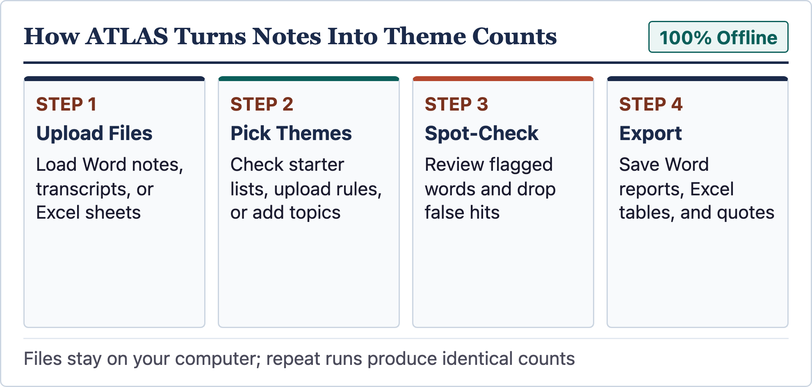
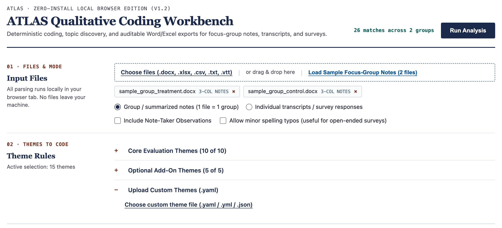
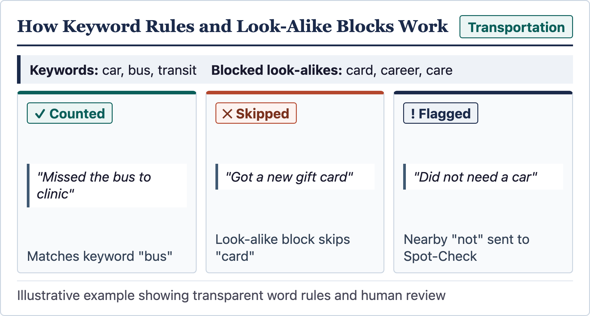
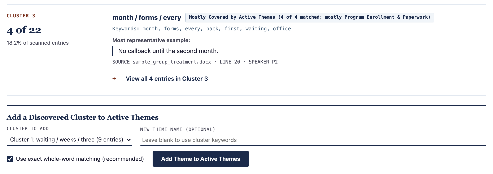
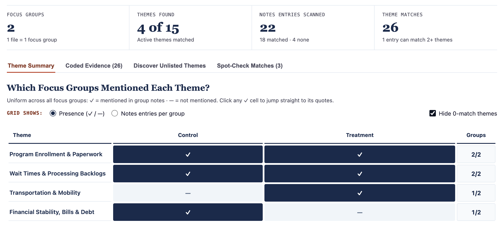
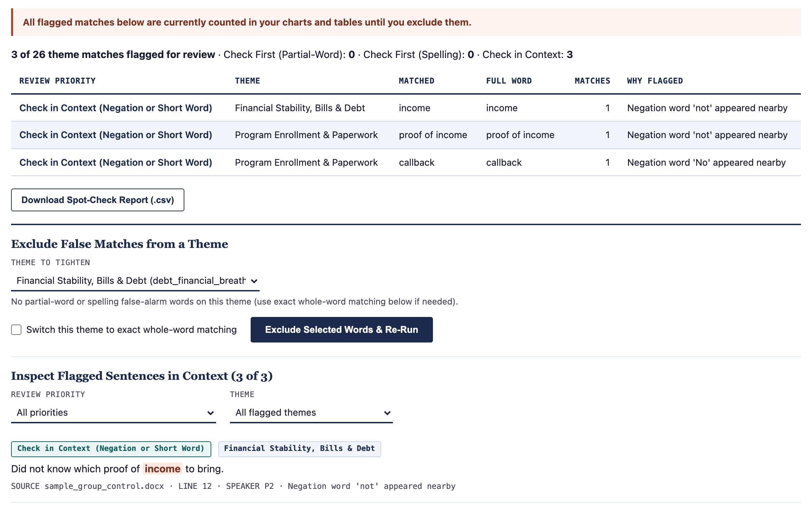
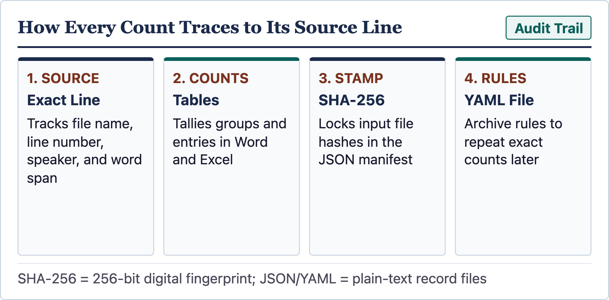

# ATLAS User Guide (v1.2)

**Automated Text-to-Ledger Actuarial Synthesis (ATLAS)** is a private, offline tool for counting themes in focus-group notes, transcripts, and open-ended surveys. It works like a fast highlighter and tally sheet on your own laptop. It is not generative artificial intelligence (AI). Because it runs on clear word lists that you control, it never rewrites quotes. Repeat runs on the same files always give the exact same counts.

> **Practice Data Note:** Screen examples in this guide use built-in sample files (`SOFTWARE_TEST`). They show how the tool works. They are not real study findings.

---

## Contents

**Part 1 — Plain-English User Guide**
1. [What ATLAS Does (and What It Does Not Do)](#1-what-atlas-does-and-what-it-does-not-do)
2. [How to Open ATLAS](#2-how-to-open-atlas)
3. [Preparing Your Files](#3-preparing-your-files)
4. [Running Your First Check](#4-running-your-first-check)
5. [How to Add a Theme or Custom Theme Library](#5-how-to-add-a-theme-or-custom-theme-library)
6. [Reading Your Results and Checking Quotes](#6-reading-your-results-and-checking-quotes)
7. [Running the 5-Minute Spot-Check](#7-running-the-5-minute-spot-check)
8. [Downloading Reports, Charts, and Tables](#8-downloading-reports-charts-and-tables)

**Part 2 — Technical Appendix and Glossary**
- [Appendix A. Writing a Custom Theme File (YAML Syntax and Rules)](#appendix-a-writing-a-custom-theme-file-yaml-syntax-and-rules)
- [Appendix B. Python Desktop Setup and Local Security Flags](#appendix-b-python-desktop-setup-and-local-security-flags)
- [Appendix C. Topic Discovery, Spelling Checks, and Survey Intervals](#appendix-c-topic-discovery-spelling-checks-and-survey-intervals)
- [Appendix D. Audit Trail, File Fingerprints, and Manifests](#appendix-d-audit-trail-file-fingerprints-and-manifests)
- [Appendix E. Troubleshooting Common Messages](#appendix-e-troubleshooting-common-messages)
- [Appendix F. Plain-English and Technical Glossary](#appendix-f-plain-english-and-technical-glossary)

---

## Part 1 — Plain-English User Guide

### 1. What ATLAS Does (and What It Does Not Do)

Reading focus-group notes by hand takes days. Manual counts can also drift when two people code the same file. Generative AI tools run fast, yet they can invent text or drop speaker tags.

ATLAS fills that gap on your own machine in four steps:

1. **Reads your files cleanly.** ATLAS loads Word notes, transcripts, or Excel sheets. For 3-column focus-group notes, it skips question headings, room headers, and consent boxes. Prompt words never inflate your counts.
2. **Matches lines against plain word lists.** Each theme pairs everyday words with look-alike blocks. For example, Transportation matches `car` while skipping `card` and `career`.
3. **Counts on the right base.** For focus-group notes, ATLAS counts the number of groups that raised each theme (`1 file = 1 group`). It also splits direct quotes from note-taker summaries. For surveys, it counts one unit per person or answer row.
4. **Builds files you can share.** You can save a Word summary report with a chart, an Excel workbook, direct quotes in a Comma-Separated Values (CSV) file, and a chart graphic.

ATLAS does **not** rewrite quotes, guess mood, translate text, or send files to the cloud. Every file stays on your computer.



---

### 2. How to Open ATLAS

Both ways of opening ATLAS produce the exact same counts and reports.

* **Zero-Install Browser Edition (best for most users):** Open `ATLAS_Workbench.html` (or `ATLAS_Workbench.aspx` on SharePoint) in Microsoft Edge or Google Chrome. Nothing installs on your laptop, and your files stay in local browser memory.
* **Python Desktop App (optional):** Inside the desktop folder, double-click `run.command` on Mac or `run.bat` on Windows. See **Appendix B** for full setup steps.

---

### 3. Preparing Your Files

You do not need a special template. Before you upload, remove direct participant names and phone numbers so your exports stay safe to share.

| File Type | How ATLAS Reads It |
| :--- | :--- |
| **3-column Word notes (`.docx`)** | Reads tables with `Key Points`, `Notable Quotes`, and `Observations` columns in any order. Skips room headers, consent rows, and question prompts. |
| **Word transcripts (`.docx`)** | Reads speaker lines or speaker/text tables, including Microsoft Teams exports. |
| **Excel or CSV surveys (`.xlsx`, `.csv`)** | Reads one survey answer per row. Keeps extra columns intact; you pick one sheet tab and one text column. |
| **Plain text or captions (`.txt`, `.md`, `.vtt`, `.srt`)** | Reads lines with speaker tags like `Facilitator:` or `P1:`, plus Zoom and Teams captions. |

#### Tips for Excel Surveys

* **Pick one tab and one column at a time.** When a workbook holds two or more tabs, ATLAS shows a **Choose Excel tab** menu. Pick the text column you want to code.
* **Blank cells stay separate.** ATLAS skips empty cells in that column and prints `X written answers scanned (Y rows left this question blank)`. That blank share counts only empty comment boxes, not your full study participation rate.
* **Repeated Respondent IDs across waves.** Sometimes one person answers in Quarter 1 and Quarter 4. Pick **Keep each row as its own response** to track each wave. Pick **Combine repeated rows under one Respondent ID** to count each person once.

#### Five-Second Check for Audio Transcripts

Open your transcript for five seconds before you upload. Check that lines start with speaker tags like `Facilitator:` and `P1:`.

* **Zoom or Microsoft Teams calls:** Export the transcript straight from Teams (`.docx` or `.vtt`) or Zoom (`.vtt`). Those exports attach speaker tags on their own.
* **In-person room recordings:** Turn on "identify different speakers" (speaker diarization) in your transcript tool. Use Word Find and Replace to rename the moderator to `Facilitator:`.
* **No speaker tags:** ATLAS still reads every paragraph cleanly in Group Mode (`1 file = 1 group`). It does not split a single file into separate question units.

---

### 4. Running Your First Check

1. **Add files under `01 · Input Files`.** Click **Choose files**, drag files into the box, or click **Load Sample Focus-Group Notes** to try the built-in practice notes.
2. **Check the mode.** When ATLAS detects 3-column focus-group notes, it picks **Group / summarized notes (1 file = 1 group)**. Leave **Include Note-Taker Observations** unchecked unless you want note-taker notes coded alongside participant speech.
3. **Set the spelling check (optional).** Leave **Allow minor spelling typos** unchecked for typed notes. Check it for survey boxes where people may type `gorceries` instead of `groceries`.
4. **Pick themes under `02 · Themes to Code`**, then click **Run Analysis** at the top right. After any later edit to files or themes, click the button again to refresh your tables.



---

### 5. How to Add a Theme or Custom Theme Library

Every count comes from open word lists that you can read and change. You do not need to write code. You can add or change themes in three ways.

#### Way 1: Turn Starter Themes On or Off

Under **Themes to Code**, open either built-in drawer.

* **Core Evaluation Themes (10 themes, checked by default):** Housing, Food, Bills and Debt, Employment, Education, Transportation, Childcare, Healthcare, Mental Health, and Legal.
* **Optional Add-On Themes (5 themes, unchecked by default):** Enrollment and Paperwork, Benefit Cliffs, Utility Shutoffs, Wait Times, and Language Access.

Uncheck themes you do not need, or click **Select all** or **Clear**. Then click **Run Analysis**.

#### Way 2: Upload a Custom Theme Library File

Teams can load a shared plain-text YAML Ain't Markup Language (`.yaml` or `.yml`) theme file in both editions. The Browser Edition also accepts JavaScript Object Notation (`.json`) files:

1. Open **Upload Custom Themes (.yaml)** under **Themes to Code**.
2. Click **Choose custom theme file** and select your `.yaml` file (or `.json` in the Browser Edition).
3. Pick **Use uploaded themes only** (to replace starter themes) or **Combine with checked themes above** (to add your custom file on top).
4. Click **Run Analysis**.

Each rule pairs everyday keywords with look-alike blocks so short words do not count unrelated terms.



#### Way 3: Find a New Topic Inside ATLAS and Save Your Library

Suppose people talk about a new topic—like prepaid card fees or clinic hours—that sits outside your theme list:

1. Run your files, then open the **Discover Unlisted Themes** tab.
2. ATLAS groups lines by shared words without using your theme list. Read clusters marked **Mostly Uncoded by Active Themes** or **Partially Uncoded** first.
3. Check the keywords and **Most representative example**, or open **View all entries** to read every line in that group.
4. Go to **Add a Discovered Cluster to Active Themes**. Pick the cluster, type a clear name, and keep **Use exact whole-word matching** checked so short words stay clean.
5. Press **Add Theme to Active Themes** so ATLAS appends the new topic and updates your counts right away.
6. To keep and share that library with your team, open **Exports & Audit Files** and click **Save Active Themes (.yaml)**. Next quarter, teammates can load that exact `.yaml` file under **Upload Custom Themes**.



---

### 6. Reading Your Results and Checking Quotes

At the top of **Themes & Quotes**, four headline cards keep every count in sync.

* **Focus Groups** (or **Analytical Units** for surveys): The count of focus groups or survey answers that ATLAS coded.
* **Themes Found:** The count of active themes that matched at least one line.
* **Notes Entries Scanned** (or **Written Answers Scanned**): Total lines read, split into matched and unmatched lines.
* **Theme Matches:** Count of entry-theme hits. One line about rent and food counts in both themes.

Below the cards, **Theme Summary** gives two clear views for focus groups.

1. **Group × Theme Grid:** Shows a checkmark (`✓`) when a group raised a theme and a dash (`—`) when not. Click any `✓` tile to jump to those quotes. You can switch to entry counts or check **Hide 0-match themes**.
2. **Bar Chart and Theme Table:** Shows matched entries per theme, split into **Direct Quotes** and **Paraphrased Key Points**. Entry counts track note volume, not a headcount of people who agreed.



#### Checking Quotes Safely in Coded Evidence

Open **Coded Evidence** to read every matched line with its matched word highlighted. Filter by **Theme**, **Source File**, **Question**, **Speaker**, or search text. On large files, browse 50 rows per page or click **Show all**.

Before you paste a quote into slides or a brief, check **Verbatim Quotes Only** (labeled **Quotable Verbatim Only** in the Python app). That box hides paraphrased key points and note-taker observations so you never put a summary inside quotation marks.

---

### 7. Running the 5-Minute Spot-Check

Before you share counts, spend five minutes on **Spot-Check Matches**. **Every flagged match stays in your charts and tables until you exclude it.**

ATLAS puts flagged hits into two plain review lists.

* **Check First (Partial-Word or Spelling Match):** A short keyword matched inside a longer word (like `car` inside `carpet`). Or the typo check caught a 1-letter misspelling (like `gorceries`).
* **Check in Context (Negation or Short Word):** A word like `not`, `no`, or `never` sat near the match (for example, `"we did not have rent trouble"`).

Scroll to **Inspect Flagged Sentences in Context** to read each highlighted line. To drop a false hit, check its word under **Exclude False Matches from a Theme**. You can also check **Switch this theme to exact whole-word matching**. Then click **Exclude Selected Words & Re-Run**. Your charts, tables, and downloads update at once—you do not need to click **Run Analysis** again. In the Python app, click **Save active themes (.yaml)** in the sidebar if you switch files, because clicking **Run Analysis** there reloads the sidebar theme boxes.

Also open **Excluded Questions & Session Headers** at the bottom of **Theme Summary** once per batch to confirm that ATLAS skipped only facilitator prompts and headers.



---

### 8. Downloading Reports, Charts, and Tables

Right under **Theme Summary** (and inside **Exports & Audit Files**), one-click buttons save outputs that match your screen:

| Button | File Saved | Best Used For |
| :--- | :--- | :--- |
| **Download Full Report (.docx)** | `atlas_summary_report.docx` | Sharing a printable Word summary with an embedded bar chart, presence grid, direct quotes, and a Technical Appendix in the back. |
| **Download Theme Frequencies (.xlsx)** | `atlas_theme_frequencies.xlsx` (Browser) or `actuarial_parameter_matrix.xlsx` (Python) | Reviewing full counts and all coded rows in Excel without preview limits. |
| **Download Direct Quotes (.csv)** | `direct_quotes_inventory.csv`, `verbatim_entries_inventory.csv`, or `coded_evidence_inventory.csv` (Browser); `verbatim_quotes_inventory.csv` (Python) | Pulling direct quotes or full coded rows into slides and memos. |
| **Download Chart (.svg)** *(Browser Edition)* | `atlas_theme_chart.svg` *(in Python, use the chart `...` menu or the chart embedded inside the Word report)* | Dropping a crisp Scalable Vector Graphics (SVG) chart into slides or web briefs. |
| **Save Active Themes (.yaml)** | `atlas_active_codebook.yaml` | Archiving and sharing your exact theme rules with teammates. |

---

## Part 2 — Technical Appendix and Glossary

This appendix records rule syntax, desktop launch flags, statistical formulas, and audit details for methodologists and technical staff.

### Appendix A. Writing a Custom Theme File (YAML Syntax and Rules)

Analysts can edit themes inside the app or write a YAML Ain't Markup Language (YAML) file in any plain-text editor. Both the Browser Edition and Python engine compile custom files with identical matching rules:

```yaml
project: "Example SOFTWARE_TEST theme library"
match_mode: prefix             # optional default: "prefix" (default) or "exact"
domains:
  - id: TRANSIT
    name: Transportation Barriers
    match_mode: exact          # prevents "car" matching "card" or "career"
    roots_en: ["bus", "transit", "fare", "car"]
    roots_es: ["autobús", "transporte"]
    context_fences: ["appointment", "clinic", "cita"]
    context_window: 8          # fence word must appear within 8 words of the root
  - id: CHILDCARE
    name: Childcare Access
    roots_en: ["childcare"]
    exclude_fences: ["not a problem"]
    exclude_window: 3          # vetoes root matches within 3 words of the phrase
```

* **Prefix vs. exact matching:** In `prefix` mode (default), keywords match case- and accent-insensitively at word starts (`evict` matches `eviction`; `autobus` matches `autobús`). Setting `match_mode: exact` enforces whole-word boundaries on both ends.
* **Context fences:** When `context_fences` has words, a keyword counts only if a fence word also appears in the entry (or within `context_window` words).
* **Exclusion fences:** Without `exclude_window`, an exclusion phrase vetoes the theme for the full entry. Setting `exclude_window: 0` vetoes only the exact overlapping word (blocking `card` while keeping a real `car` elsewhere in the sentence), whereas a positive whole number `N` blocks hits within `N` words.
* **Accepted top-level keys:** Both editions accept `.yaml` / `.yml` files using `domains` (`roots_en`, `roots_es`, `roots`), `topics` (`label`, `keywords`, `required_context`, `context_window`), or `themes` + `frictions`. The Browser Edition also accepts `.json` files with the same fields.

### Appendix B. Python Desktop Setup and Local Security Flags

The Browser Edition (`ATLAS_Workbench.html` / `.aspx`) needs no install. For the Python desktop folder (`atlas`), launch with the bundled scripts:

* **macOS / Linux:** Open `run.command` (or enter `bash run.command` in Terminal).
* **Windows:** Open `run.bat`.
* **Check-only mode:** Pass `--check-only` to either script to build the local Python virtual environment (`.venv`) and test imports without opening a browser tab.
* **Localhost binding:** Both scripts pass `--server.address=localhost` and `--browser.gatherUsageStats=false` so Streamlit listens only on the local loopback address (`http://localhost:8501`) and sends zero telemetry. Inside the app, open the **Reference Guides** tab to read guides or save formatted Word copies from the sidebar.

### Appendix C. Topic Discovery, Spelling Checks, and Survey Intervals

* **Offline Topic Discovery (`TF-IDF + NMF`):** **Discover Unlisted Themes** builds a Term Frequency–Inverse Document Frequency (TF-IDF) matrix over participant entries (filtering out speaker tags `p0`–`p99`) and clusters entries deterministically (`seed = 42`) using **Non-Negative Matrix Factorization (NMF)** by default. Classic **Latent Dirichlet Allocation (LDA)** is also selectable under **Method settings** in the Python app. Each cluster shows its **medoid** (the real entry closest to the cluster center) and its one-to-one overlap against active themes.
* **Bounded Spelling Tolerance:** Turning on **Allow minor spelling typos** applies Damerau-Levenshtein edit distance 1 (`DL=1`: one insertion, deletion, substitution, or adjacent swap) to single-word keywords of 5 or more characters. ATLAS never alters original text, enforces all context and exclusion fences, and routes every rescued typo into **Spot-Check Matches** under *Check First (Spelling Match)*.
* **Individual Survey Intervals and Group Guardrail:** In **Individual Mode** (independent transcripts or survey rows), **Exports & Audit Files** reports prevalence $p = \text{units reporting} / N$, the Binomial Standard Error ($\text{SE} = \sqrt{p(1 - p)/N}$), and a 95% Confidence Interval ($95\%\text{ CI} = p \pm 1.96 \cdot \text{SE}$, clipped to `0–100%`). In **Group Mode**, ATLAS hides Binomial SE and 95% CI intervals because small focus-group counts and clustered room discussions violate independent Binomial sampling.

### Appendix D. Audit Trail, File Fingerprints, and Manifests

Every run writes `provenance_manifest.json` with exact counts, theme digests, and a **Secure Hash Algorithm 256-bit (SHA-256)** digital fingerprint for each uploaded source file. In the Python edition, exported Excel prevalence cells carry `ATLAS VERIFICATION AUDIT STAMP` comments checked against the manifest before download.



### Appendix E. Troubleshooting Common Messages

| Message or Symptom | Cause and Fix |
| :--- | :--- |
| `Select at least one theme...` | You cleared every Core and Add-On theme without uploading a custom file. Check at least one theme or upload a `.yaml` file (`.json` also works in the Browser Edition) before clicking **Run Analysis**. |
| `Uploaded Excel workbooks have different sheet names` | Multiple `.xlsx` files do not share a worksheet tab name. Upload workbooks with different tab layouts one at a time. |
| `Repeated Respondent IDs` in a survey | Pick **Keep each row as its own response** (for quarterly waves) or **Combine repeated rows under one Respondent ID** (for unique-person prevalence). |
| `... must be a nonnegative whole token count` | A `context_window` or `exclude_window` value in a custom `.yaml` file is negative, fractional, or text. Supply a whole number such as `0`, `5`, or `8`. |
| Unexpected false hits on short words | Open **Spot-Check Matches**, check the look-alike words, and click **Exclude Selected Words & Re-Run** (or switch the theme to exact whole-word matching). |
| All theme counts are `0` | None of the selected theme keywords appeared in participant entries. Open **Discover Unlisted Themes** to inspect the words participants used. |
| A speaker's turns are missing in a transcript | ATLAS auto-detected that speaker as the facilitator. Enter the true facilitator name under **Advanced transcript filters**. |

### Appendix F. Plain-English and Technical Glossary

| Term | Plain-English Meaning |
| :--- | :--- |
| **ATLAS** | Automated Text-to-Ledger Actuarial Synthesis: an offline workbench that counts transparent keyword themes in qualitative files. |
| **Analytical Unit** | The denominator used for prevalence: one focus-group file (`1 file = 1 group`) in Group Mode, or one transcript/survey unit in Individual Mode. |
| **Context Fence** | A companion word that must appear near a keyword for the match to count. |
| **CSV** | Comma-Separated Values: a plain spreadsheet file that opens in Excel or any data tool. |
| **DL=1** | Damerau-Levenshtein distance 1: a 1-character spelling difference (one missing, extra, swapped, or wrong letter) used by the optional typo check. |
| **Entry / Turn** | One coded piece of text: a participant bullet or quote in focus-group notes, a survey answer row, or a speaker turn in a transcript. |
| **Exclusion Fence** | A look-alike word or phrase (such as `card` under Transportation) that blocks a false keyword match. |
| **JSON** | JavaScript Object Notation: a plain-text file format used for `provenance_manifest.json` in both editions and optional custom theme files in the Browser Edition. |
| **LDA** | Latent Dirichlet Allocation: a classic probabilistic topic-clustering method available under **Method settings** in the Python app. |
| **Medoid** | The real participant entry closest to the center of a discovered topic cluster (**Most representative example**). |
| **NMF** | Non-Negative Matrix Factorization: the default deterministic offline method ATLAS uses in **Discover Unlisted Themes**. |
| **Prefix vs. Exact Match** | Prefix mode matches word starts (`evict` → `eviction`); exact mode matches complete whole words only. |
| **SE and 95% CI** | Binomial Standard Error and 95% Confidence Interval, shown only for independent Individual Mode surveys and hidden for focus groups. |
| **SHA-256** | Secure Hash Algorithm 256-bit: a unique digital fingerprint of an input file that proves the exact source file used in a run. |
| **SOFTWARE_TEST** | Label on built-in synthetic practice files used solely to show how ATLAS works, never real study results. |
| **Source Type** | Tag separating direct participant speech (**Direct Quote** / **Verbatim Quote**) from note-taker summaries (**Key Point Summary** / **Paraphrase** and **Note-Taker Observation**). |
| **SVG** | Scalable Vector Graphics: a sharp image format for exported charts that stays crisp at any print or slide size. |
| **TF-IDF** | Term Frequency–Inverse Document Frequency: a word-weighting score that highlights distinctive words across entries during topic discovery. |
| **YAML** | YAML Ain't Markup Language: a human-readable plain-text file format (`.yaml`) used to save, edit, and share ATLAS theme libraries. |

### Questions or Help Adapting ATLAS

If you have questions or need help using or adapting ATLAS for your project, contact **Victoria Cholette** on GitHub ([@dphdame](https://github.com/dphdame)) or by email at [hello@tooearlytosay.com](mailto:hello@tooearlytosay.com).
